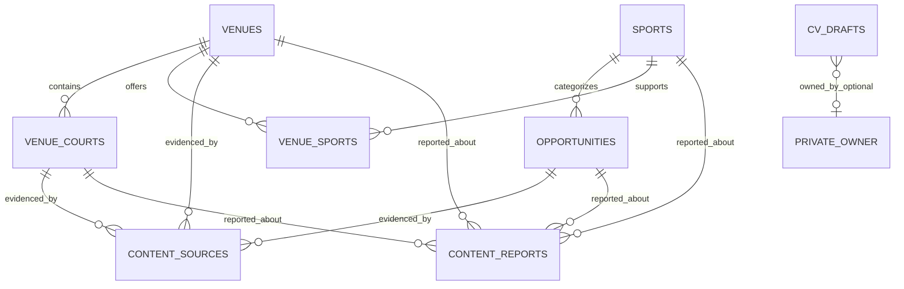

# KhelGrid Balanced MVP — Domain Model and Data Dictionary

**Status:** Planning baseline only.  
**Project boundary:** Separate `khelgrid-platform` development project. No production repository, database, or deployment changes are authorized by this document.  
**Purpose:** Establish a shared vocabulary and proposed data contracts before implementation or schema expansion. This is not an applied database migration.

## 1. Domain principles

1. **One source of truth per fact.** Do not copy venue details or opportunity status into unrelated tables as independently editable values.
2. **Separate identity, content and publication.** A submitted record is not automatically public; publication is an authorized state transition.
3. **Preserve provenance.** External information must have a traceable source and review history. Public visibility is not proof of accuracy or permission to republish.
4. **Minimize personal data.** Collect only what a feature needs. Sports CV drafts are private by default.
5. **Use stable identifiers.** Use immutable IDs for relationships; slugs are for readable URLs and can change.
6. **Validate in trusted layers.** Validate at the UI and service boundary, then enforce critical constraints and authorization in the database/backend.
7. **Keep lifecycle explicit.** Draft, submitted, published, expired, archived and removed are distinct states with documented transitions.
8. **Plan for web and mobile together.** Domain rules and API contracts should not depend on React components or a specific client.
9. **Do not invent data.** Unknown fields stay null/unknown; prices, ratings, availability, dates and verification claims require evidence.
10. **Free-tier and privacy constraints apply.** Design within approved resource limits and do not add paid services or expose privileged keys without approval.

## 2. Proposed entity map

This is a conceptual map, not SQL. A normalized source model may use a source-link table or typed foreign keys rather than polymorphic references; choose a referentially safe implementation after inspecting current migrations. `PRIVATE_OWNER` is a conceptual placeholder, not a proposed user table.

## 3. Common field conventions

| Convention | Proposed rule |
|---|---|
| Primary ID | UUID or another stable opaque ID; never use a mutable slug as a foreign key |
| Timestamps | Store instants in UTC; render in the viewer's local timezone with timezone context for event dates |
| Date-only fields | Use a date type for deadlines/event dates when no exact time is known; do not invent midnight times |
| Currency | Store numeric amount and ISO currency separately; never parse display text as the authoritative price |
| Unknown values | Use null/explicit unknown status; do not silently substitute zero, free, unavailable, or verified |
| Slugs | Unique within the relevant route namespace; support redirect history when changed |
| Public content | Explicit publication state plus authorized transition and audit record |
| External source | Store canonical source URL, source identity where allowed, retrieval/check timestamps and permitted-use notes |
| Deletion | Define hard-delete, anonymize, archive or tombstone behaviour per entity and legal/security needs |
| Validation | Define length, format, range, allowed enum and relationship rules; validate again on trusted server/database |
| Text and rendering | Treat user/source text as untrusted; encode safely and restrict uploaded media |
| Versioning | API/domain contracts have a version or compatible change policy; DB migrations are separate from API versioning |

## 4. Entity dictionary

The following are **proposed MVP concepts**. Field names and types are logical guidance, not committed SQL column names.

### 4.1 Sports

**Purpose:** Controlled catalogue of supported sports and canonical public sport pages.

| Field | Logical type | Required? | Rules |
|---|---|---:|---|
| id | Stable ID | Yes | Primary key |
| name | Text | Yes | Curated display name |
| slug | Slug | Yes | Unique, canonical URL segment |
| summary | Text | No | Reviewed, factual, useful copy |
| status | Enum | Yes | Proposed: draft, published, retired |
| sort_order | Integer | No | Presentation only, not evidence of popularity |
| created_at / updated_at | Timestamp | Yes | Managed by trusted layer |

**Relationships:** one sport can categorize many opportunities and relate to many venue-sport offerings.  
**Rules:** do not create indexable pages for unsupported sports or thin content. Retiring a sport must preserve record history and resolve old URLs consistently.

### 4.2 Opportunities / trials

**Purpose:** Sourced discovery records for trials, selection events, combines, scholarships, camps and similar opportunities.

| Field | Logical type | Required? | Rules |
|---|---|---:|---|
| id | Stable ID | Yes | Primary key |
| sport_id | Foreign key | Usually | Must reference supported sport when categorized |
| title | Text | Yes | Descriptive, not misleading |
| slug | Slug | Yes for public route | Stable canonical route; may change with redirect history |
| organizer_name | Text | Required for publication where applicable | Do not imply organizer endorsement |
| summary/details | Text | Publication gate | Factual, reviewed and appropriately attributed |
| event_start / event_end | Date/time or date | If known | Preserve uncertainty and timezone |
| application_deadline | Date/time or date | If known | Must not be guessed |
| location_name / city / region / country | Text or normalized location | As applicable | Publish only necessary location precision |
| eligibility | Text/structured criteria | Where available | Unknown criteria remain unknown |
| fee_status | Enum | Yes for publication | Proposed: known_fee, explicitly_free, unknown |
| fee_amount / currency | Decimal + ISO currency | Conditional | Required only for known fee; non-negative; never infer from absence |
| application_method / contact details | Structured text/URL | Where available | Validate URLs and minimize personal contact exposure |
| lifecycle_status | Enum | Yes | Proposed states below |
| publication_status | Enum | Yes | Separate moderation/public visibility from event lifecycle |
| source/check metadata | Relationship/fields | Required for sourced publication | Source rights and freshness review required |
| created_at / updated_at | Timestamp | Yes | Managed |
| published_at / expires_at | Timestamp | Conditional | Set by trusted transition/rules, not arbitrary client claims |

**Suggested lifecycle:** draft → submitted → in_review → published → closed/expired → archived; rejected and removed are separate terminal/review outcomes. A record can be event-active but unpublished; therefore event lifecycle and publication status must not be conflated.

**Publication requirements:** credible evidence/source; relevant sport/title/organizer; date or explicit date uncertainty; location/eligibility/fee/contact fields where applicable; freshness check; duplicate review; permitted-use decision; moderation approval.

**Validation:** date order is coherent; known fee has amount and currency; explicit free is not inferred from missing amount; links use allowed schemes; publication cannot occur without required evidence and reviewer authorization.

### 4.3 Venues

**Purpose:** Public directory entry for a sports venue/complex.

| Field | Logical type | Required? | Rules |
|---|---|---:|---|
| id | Stable ID | Yes | Primary key |
| name | Text | Yes | Verified spelling where possible |
| slug | Slug | Yes for public route | Unique canonical route |
| description | Text | Publication gate | Reviewed and factual |
| address display / city / region | Text or normalized location | As applicable | Avoid unnecessary exact personal/residential address exposure |
| latitude / longitude | Decimal | Optional | Only if sourced/consented and needed; apply location privacy review |
| public contact | Text/URL | Optional | Publish only with permission/legitimate basis |
| lifecycle_status | Enum | Yes | Proposed: active, temporarily_closed, permanently_closed, unknown |
| publication_status | Enum | Yes | draft, submitted, in_review, published, rejected, archived, removed |
| ownership/verification claim | Evidence relation/state | Optional | Never infer ownership from submission |
| source/check metadata | Relationship/fields | Required for sourced publication | Review source permission and freshness |
| created_at / updated_at | Timestamp | Yes | Managed |

**Rules:** a submission is not proof of ownership. Verification labels must state what was checked and when, rather than making broad guarantees. Do not publish private contact details or exact location data without review.

### 4.4 Venue courts / facilities

**Purpose:** A bookable-sounding court or facility entry within a venue, without implying that booking is available in MVP.

| Field | Logical type | Required? | Rules |
|---|---|---:|---|
| id | Stable ID | Yes | Primary key |
| venue_id | Foreign key | Yes | Must reference venue |
| name | Text | Yes | Unique or disambiguated within venue |
| sport_id / supported sports | Foreign key or relation | As applicable | Do not assume one court supports every sport |
| facility_type | Enum/text | Optional | Curated vocabulary where feasible |
| facilities/features | Structured list | Optional | Published only if reviewed |
| pricing data | Structured price relation/value | Optional | Only supported published prices; MVP does not offer reservation |
| opening hours | Structured schedule | Optional | Timezone and exceptions must be defined before booking |
| publication_status | Enum | Yes | Cannot be public if parent venue is unpublished/removed |
| created_at / updated_at | Timestamp | Yes | Managed |

**Rules:** venue visibility constrains child visibility. A court listing is descriptive only; it is not proof of current slot availability or a reservation. Pricing may be omitted until reliably sourced and reviewed.

### 4.5 Venue-sport relationship

**Purpose:** Express sports offered by a venue without duplicating venue details.

| Field | Logical type | Required? | Rules |
|---|---|---:|---|
| venue_id | Foreign key | Yes | References venue |
| sport_id | Foreign key | Yes | References sport |
| evidence/source | Relation | As applicable | Support claim of sport offered |
| created_at | Timestamp | Yes | Managed |

**Constraint:** unique pair of venue_id + sport_id unless a reviewed domain reason requires separate offerings.

### 4.6 Content sources / provenance

**Purpose:** Keep evidence and permitted-use decisions for external information.

| Field | Logical type | Required? | Rules |
|---|---|---:|---|
| id | Stable ID | Yes | Primary key |
| canonical_url | URL | Yes where applicable | HTTPS preferred; validate scheme and destination |
| source_name | Text | Yes | Human-readable publisher/provider |
| source_record_id | Text | Optional | Store only if terms permit |
| entity type + entity ID | Typed relationship | Yes | Prefer explicit typed foreign keys/source-link tables for referential integrity |
| permitted_use_status | Enum | Yes | Proposed: pending_review, permitted, restricted, prohibited, expired |
| attribution_required | Boolean/text | Yes | Record exact requirement/format |
| retrieved_at / checked_at | Timestamp | Yes | Distinguish retrieval from human review |
| reviewed_by / reviewed_at | Internal reference/timestamp | Conditional | Reviewer identity is internal, not necessarily public |
| freshness_until | Timestamp/date | Optional | Per-source policy; not a universal expiry |
| notes | Restricted text | Optional | Avoid secrets or unnecessary personal data |

**Rules:** a source being accessible does not prove permission to scrape or republish. No item should publish while required permission review is pending or prohibited. Keep source terms, API limits, attribution and retention limits in a separate provider register as needed.

### 4.7 Content reports / corrections

**Purpose:** Accept reports of inaccurate, expired, unsafe or potentially infringing content.

| Field | Logical type | Required? | Rules |
|---|---|---:|---|
| id | Stable ID | Yes | Primary key |
| target entity type + ID | Typed relationship | Yes | Must identify a valid target |
| reason | Controlled enum | Yes | Examples: outdated, incorrect, unsafe, copyright, impersonation, other |
| description | Text | Optional with limits | Sanitize/render safely; warn against unnecessary sensitive data |
| reporter contact | Optional protected field | No | Collect only if follow-up is needed and consented |
| status | Enum | Yes | received, triaged, investigating, resolved, dismissed |
| assigned_to / reviewed_by | Internal identity reference | Conditional | Restricted |
| created_at / updated_at / resolved_at | Timestamp | Yes/conditional | Audit timeline |
| outcome note | Restricted text | Conditional | Do not disclose reporter's personal information publicly |

**Rules:** report records are private; rate-limit and spam-protect intake; reports do not automatically alter publication status. High-risk reports have an escalation path and auditable decision.

### 4.8 Sports CV draft

**Purpose:** Create and export a sports CV while minimizing privacy exposure.

| Field | Logical type | Required? | Rules |
|---|---|---:|---|
| draft_id | Stable ID | Yes if persisted | Prefer local/session draft ID if generated locally |
| owner_id | User reference | Only if account storage is later enabled | No account dependency for initial local workflow |
| personal/profile fields | Structured private data | Per field inventory | Minimize collection; avoid unnecessary sensitive data |
| sports/achievements | Structured list | Optional | Validate length/date/format; no unsupported verification claims |
| education/coaching/contact | Structured fields | Optional | Explain purpose; protect contact data |
| created_at / updated_at | Timestamp | If persisted | Managed |
| retention/deletion state | Policy metadata | If persisted | Defined retention, delete/export behaviour |

**Rules:** decide local-only versus private backend persistence before implementation. CV content is not a public athlete profile, is not indexed, and is not shared by default. Do not send CV field values to analytics. For minors, conduct a specific privacy/safety review before enabling data collection or sharing.

### 4.9 Editorial/help/legal content

**Purpose:** Provide useful platform, support, safety and policy pages.

| Field | Logical type | Required? | Rules |
|---|---|---:|---|
| id / slug | Stable ID / slug | Yes | Unique canonical route |
| title / body | Text | Yes | Reviewed and accessible |
| status | Enum | Yes | draft, published, retired |
| owner/reviewer | Internal reference | Conditional | Accountability |
| reviewed_at / next_review_at | Timestamp/date | Conditional | Review cycle for policy/factual pages |
| revision history | Audit/version relation | Recommended | Keep material changes traceable |

**Rules:** policies must match actual behaviour and be reviewed for the operating jurisdiction. Placeholder content is not legal sign-off.

## 5. Shared lifecycle and state models

### Publication state (content entities)

Proposed shared vocabulary:
- `draft`: internal, not submitted.
- `submitted`: awaiting review; not public.
- `in_review`: moderation in progress; not public.
- `published`: approved for public display.
- `rejected`: submission declined; reason recorded privately where appropriate.
- `archived`: no longer actively promoted; visibility governed by entity policy.
- `removed`: withheld from public view for safety, rights, policy or correction reasons.

Only authorized roles/services may transition to published or removed. Preserve audit history for consequential transitions.

### Opportunity event state

Separate from publication:
- `upcoming`
- `open` (only when application is actually open based on evidence)
- `closed`
- `expired`
- `date_unknown`

Event state should be computed or updated by trusted logic using documented date/deadline semantics. It must not make an unpublished record public. Avoid assuming an event is open merely because its deadline is missing.

### Venue operating state

- `active`
- `temporarily_closed`
- `permanently_closed`
- `unknown`

Operating state is not booking availability. A venue marked active may still have no confirmed open slot.

### Source permission state

- `pending_review`
- `permitted`
- `restricted`
- `prohibited`
- `expired`

Publishing rules must enforce the applicable permitted-use requirements. Restricted use may require limited fields, attribution, caching or retention controls.

### Report state

- `received`
- `triaged`
- `investigating`
- `resolved`
- `dismissed`

Do not expose internal report notes or reporter details to public users.

## 6. Relationships and integrity constraints

Proposed constraints to validate during schema design:
- Every opportunity's sport reference, when present, must reference an existing catalogue entry.
- Every court must reference an existing venue; public court visibility cannot exceed its parent's publication visibility.
- Venue-sport pairs are unique unless the model intentionally supports multiple distinct offerings.
- A known price requires a non-negative amount and ISO currency. An explicitly free value is distinct from unknown.
- Opportunity date ranges must be coherent; deadline semantics and timezone rules must be documented.
- Published content must satisfy required field and source/provenance checks for that entity type.
- Prohibited or expired source permissions block publication/republication where applicable.
- Slugs are unique in their route namespace; slug changes require redirects or an explicit not-found/retired policy.
- Reports are private and cannot be read/changed by unrelated public users.
- CV drafts are private to the owner or local workflow; no public query/API may retrieve another person's draft.
- Role assignment and publication transitions require trusted authorization; users cannot self-grant privileged roles.
- Deleting/archiving a parent venue must handle child courts and related URLs consistently.
- Audit records for privileged actions should be append-only or otherwise protected against ordinary editor modification.
- Apply indexes to real query patterns only after expected filters and data volume are understood; avoid premature indexing.

## 7. Privacy, retention and deletion decisions

Before implementing persistence, create a field-level data inventory including purpose, sensitivity, access roles, storage location, third-party sharing, retention and deletion behaviour.

- **Public catalogue data:** retain source/review history as needed for corrections and accountability; remove fields no longer necessary.
- **Reports:** restrict access, define retention, and avoid collecting reporter identity unless needed.
- **Sports CV:** prefer local processing for initial MVP if it meets user needs; if persisted, define ownership, secure access, export and deletion before implementation.
- **Location/contact:** publish only necessary, permissioned business contact and location detail; avoid residential addresses and precise coordinates without a clear need.
- **Minors:** do not assume adult-oriented profile or contact patterns are appropriate. Complete a dedicated privacy and safety review before collecting or sharing minors' information.
- **Logs/analytics:** exclude CV contents, credentials, tokens and unnecessary personal data.

Retention periods remain an open decision and must be based on actual purpose, law, safety, operational needs and user expectations; do not invent blanket periods in this document.

## 8. Suggested logical ownership and modules

| Domain | Owning module | Data owner / responsibility |
|---|---|---|
| Sports | Sports | Maintains supported catalogue and canonical routes |
| Opportunities | Opportunities | Listing lifecycle, source references, dates and correction handling |
| Venues/courts | Venues | Venue and court details, publication status and parent-child integrity |
| Sources | Data governance/integrations | Provider terms, provenance, refresh and permission review |
| Reports | Trust/moderation | Private report queue, triage, outcomes and audit |
| CV | Sports CV | Private draft validation, preview/export and retention behaviour |
| Editorial/policies | Platform/trust | Reviewed public guidance and policy revisions |
| Cross-cutting access | App/backend/database | Authorization, RLS, validation, logging and safe errors |

These are proposed module responsibilities, not current code structure guarantees.

## 9. Open decisions before schema implementation

- [ ] Confirm the source/provider register and which external records may legally be reused.
- [ ] Decide whether CV generation is local-only for MVP or uses private backend storage.
- [ ] Approve exact opportunity required fields, date/deadline semantics and freshness thresholds.
- [ ] Approve venue/court fields, location precision, contact publication and price evidence requirements.
- [ ] Choose source-to-entity relationship implementation that enforces referential integrity.
- [ ] Approve publication transitions, moderator roles and audit design.
- [ ] Decide report intake fields, spam protection and escalation ownership.
- [ ] Define retention/deletion and child-safety requirements for actual collected data.
- [ ] Map proposed concepts to the existing development migrations and identify any schema gaps before creating migrations.
- [ ] Write SQL constraints/RLS tests for both allowed and denied access before applying any schema changes.

## 10. Safe next step

Review this dictionary against the current development-only migrations and the starter app, identify mismatches, and produce a schema gap report. Do not apply migrations or change production resources as part of that review. Schema changes require a separately reviewed migration, tests, an intended-environment check, and explicit implementation approval.
