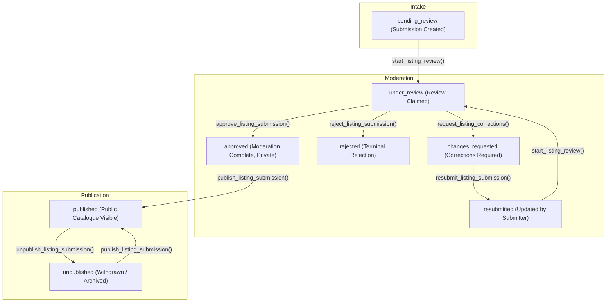

# KhelGrid Listing Moderation & Publication Workflow

## 1. Executive Overview

Phase 3 introduces an enterprise-grade, secure, multi-stage listing moderation and publication lifecycle for the KhelGrid platform. 

A central architectural invariant of KhelGrid is the **strict separation of moderation approval and catalogue publication**:
- **Approval** confirms that a submission satisfies community standards, factual accuracy, and safety requirements. It **never** automatically creates or publishes a public catalogue record.
- **Publication** is an independent, explicitly authorized moderator action that validates category-specific constraints, maps attributes into the target public catalogue table, prevents duplicates, and enables public search discovery.

---

## 2. Lifecycle State Machine

### Transition Matrix & Invariants

| From Status | Allowed Target Statuses | Authorized Actor | Required Fields / Conditions |
|---|---|---|---|
| `pending_review` | `under_review`, `rejected` | Authorized Moderator | Timestamp, moderator assignment |
| `under_review` | `approved`, `rejected`, `changes_requested` | Assigned Moderator | For `rejected`: mandatory `rejection_reason`. For `changes_requested`: mandatory `correction_request` |
| `changes_requested` | `resubmitted`, `rejected` | Submitter (with `tracking_key`) or Moderator | Submitter edits title, details, source URL; increments submission version |
| `resubmitted` | `under_review`, `rejected` | Authorized Moderator | Resets to active review queue with revision history |
| `approved` | `published`, `rejected` | Authorized Moderator | Publication requires destination table check, unique slug, and explicit `publish_listing_submission` call |
| `published` | `unpublished` | Authorized Moderator | Mandatory `unpublish_reason`; soft-deletes or archives catalogue entity |
| `unpublished` | `published` | Authorized Moderator | Re-verifies slug and re-activates catalogue entity |
| `rejected` | *(Terminal)* | System | Immutable state; records reasons and historical audits |

All transitions are strictly validated at the database layer via `enforce_listing_moderation_transition()`. Direct unauthorized modifications bypass attempt triggers and raise SQL exceptions (`KG301` through `KG308`).

---

## 3. Moderator Actions & Database Functions

### A. Start Review (`start_listing_review`)
- **Signature:** `start_listing_review(p_submission_id uuid, p_expected_version int default null)`
- **Security:** `SECURITY DEFINER` with explicit `is_listing_moderator()` check.
- **Behavior:** Transitions submission from `pending_review` or `resubmitted` to `under_review`. Sets `assigned_moderator_id = auth.uid()` and `review_started_at = clock_timestamp()`.
- **Concurrency:** Optimistic concurrency control via `p_expected_version`. Aborts if another moderator has acted concurrently.

### B. Request Corrections (`request_listing_corrections`)
- **Signature:** `request_listing_corrections(p_submission_id uuid, p_message text, p_notes text default null, p_expected_version int default null)`
- **Security:** `SECURITY DEFINER` with explicit `is_listing_moderator()` check.
- **Behavior:** Transitions from `under_review` to `changes_requested`. Stores the clear feedback in `correction_request`.
- **Submitter Visibility:** The submitter can view `correction_request` using their tracking key. Internal `notes` are logged to the audit table and never shown to the submitter.

### C. Reject Submission (`reject_listing_submission`)
- **Signature:** `reject_listing_submission(p_submission_id uuid, p_reason text, p_notes text default null, p_expected_version int default null)`
- **Security:** `SECURITY DEFINER` with explicit `is_listing_moderator()` check.
- **Behavior:** Transitions to `rejected`. Records `rejection_reason` (visible to submitter via tracking key) and detailed audit notes (moderators only). Submissions are never deleted.

### D. Approve Submission (`approve_listing_submission`)
- **Signature:** `approve_listing_submission(p_submission_id uuid, p_notes text default null, p_expected_version int default null)`
- **Security:** `SECURITY DEFINER` with explicit `is_listing_moderator()` check.
- **Behavior:** Marks the submission as `approved`.
- **CRITICAL:** **Approval does NOT create or publish a catalogue record.** The record remains strictly private and inaccessible from public discovery queries.

### E. Publish Listing (`publish_listing_submission`)
- **Signature:** `publish_listing_submission(p_submission_id uuid, p_target_slug text default null, p_sport_id uuid default null, p_expected_version int default null)`
- **Security:** `SECURITY DEFINER` with explicit `is_listing_moderator()` check.
- **Pre-Conditions:**
  1. Submission status must be `approved` or `unpublished`.
  2. Required category fields must be present and valid.
  3. Destination table must be supported.
- **Behavior:**
  1. Resolves a clean, unique slug.
  2. Inserts or updates the corresponding entity in the destination catalogue table:
     - `opportunity` → `public.opportunities` (`status = 'published'`, `is_active = true`)
     - `venue` → `public.venues` (`publication_status = 'published'`, `is_published = true`)
     - `academy` → `public.academies` (`publication_status = 'published'`, `is_published = true`)
     - `coach` → `public.coaches` (`is_active = true`, `is_published = true`)
     - `event` → `public.events` (`status = 'published'`, `is_active = true`)
     - `pickup_game` → `public.pickup_games` (`status = 'published'`, `is_active = true`)
     - `sport` → `public.sports` (`is_active = true`)
  3. Records `published_at`, `published_by`, `published_record_id`, and `published_table` on the submission row.
  4. Transitions submission status to `published`.
  5. Inserts a comprehensive audit trail entry.
  6. Operation is idempotent: repeated publish requests safely return the existing record ID.

### F. Unpublish Listing (`unpublish_listing_submission`)
- **Signature:** `unpublish_listing_submission(p_submission_id uuid, p_reason text, p_notes text default null, p_expected_version int default null)`
- **Security:** `SECURITY DEFINER` with explicit `is_listing_moderator()` check.
- **Pre-Conditions:** Submission status must be `published`.
- **Behavior:**
  1. Validates non-empty `p_reason`.
  2. Updates destination catalogue table entity to remove public discovery:
     - `opportunities`: `status = 'archived'`, `is_active = false`
     - `venues`: `publication_status = 'unpublished'`, `is_published = false`
     - `academies`: `publication_status = 'unpublished'`, `is_published = false`
     - `coaches`: `is_active = false`, `is_published = false`
     - `events`: `status = 'cancelled'`, `is_active = false`
     - `pickup_games`: `status = 'cancelled'`, `is_active = false`
     - `sports`: `is_active = false`
  3. Transitions submission status to `unpublished`.
  4. Preserves all history, references, and audit records.

---

## 4. Submitter Tracking & Resubmission Flow

1. **Intake:** Submitter submits via `/submit-listing` (or `/suggest`).
2. **Identification:** Database auto-generates:
   - `reference_number`: `KHL-YYYYMMDD-XXXX` (human-readable tracking reference).
   - `tracking_key`: Cryptographically strong 64-character token (`hex(gen_random_bytes(32))`).
3. **Tracking:** Submitter checks status at `/track-submission` using `reference_number` and `tracking_key`.
   - The status endpoint (`get_submission_tracking_status`) returns clean progress metrics, current status, rejection reason, or correction request.
   - Moderator internal notes, reviewer email, and internal UUIDs are strictly stripped.
4. **Correction & Resubmission:**
   - If status is `changes_requested`, the submitter can update title, details, and source URL via `resubmit_listing_submission`.
   - The original version is archived to `public.listing_submission_versions`.
   - The status transitions to `resubmitted`, returning it to the top of the moderator queue.

---

## 5. Audit Logging & Concurrency Control

- **Audit Ledger:** Every action, status change, and moderator comment is recorded in `public.listing_submission_audits` with actor ID, timestamp, prior status, new status, and action metadata.
- **Versioning:** Every modification increments the `version` integer column.
- **Optimistic Concurrency:** Moderator UI passes the expected version when performing actions. If another moderator acts concurrently, the mutation is rejected with `Concurrent modification detected; please refresh`, preventing accidental overwrites.
