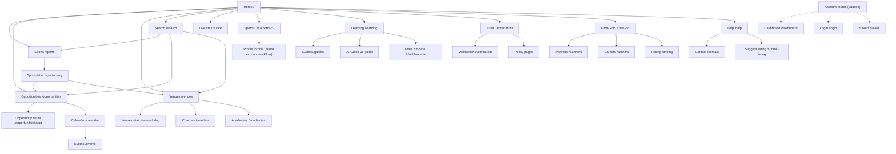

# KhelGrid Page Directory and Internal Link Map

**Status:** In Review  
**Scope:** Current route resolver and app page dispatch on the `main` baseline used for this document.  
**Purpose:** Give product, design, engineering, content, SEO and QA one readable directory of pages, aliases, parent/child relationships, and known workflow boundaries.  
**Important:** A route being registered does not mean the related service is complete, production-deployed, or connected to every required database table/provider. Confirm implementation and deployment separately.

## 1. How to use this document

- **Canonical route** is the preferred URL for a resource or page.
- **Alias** is an alternate URL that resolves to the same page; it must not create duplicate content or records.
- **Detail route** uses a real published record slug. Do not create a detail page for a fabricated or unpublished record.
- **Data-backed (code)** means the current app page contains a database-backed query path; it does not certify that production schema/configuration is present.
- **Foundation / coming soon** means navigation and/or explanatory page exists, but the full workflow is not implemented.
- **Not a live integration** means the page must not imply that scores, availability, payments, verification or other external operations are active when they are not.

For the current implementation, route resolution is in `src/shared/routing.ts` and page dispatch/layout/navigation is in `src/App.tsx`. Shared navigation components include the sidebar, sports bar, header and footer.

## 2. Main navigation and page directory

| Area | Page / purpose | Canonical route | Aliases / related routes | Current implementation notes |
|---|---|---|---|---|
| Discover | Home and primary entry point | `/` | Header brand, footer brand | Home page; links users into the catalogue and feature areas. Do not publish unsupported metrics. |
| Discover | Sports directory | `/sports` | Header search; footer Explore | Catalogue page. |
| Discover | Sport detail | `/sports/:slug` | Linked from sports cards and related content | Detail page must resolve a real published sport. |
| Discover | Unified search | `/search` | Header search; footer Explore; quick-access chips | Search query may use `?q=`; search across supported catalogue records. |
| Compete | Opportunities directory | `/opportunities` | `/trials`, `/combines`, `/scholarships`, `/camps` | One canonical directory; aliases must not duplicate listings. |
| Compete | Opportunity detail | `/opportunities/:slug` | Linked from opportunity cards/search/calendar where applicable | Real published record only; preserve source, date, eligibility and status. |
| Compete | Events directory | `/events` | `/calendar` links to date-oriented discovery | Code path queries published event records; requires compatible Supabase schema/config. |
| Compete | Sports calendar | `/calendar` | Footer Explore, quick-access chips, sports network index | Code path provides calendar/date-oriented event browsing; no fabricated events. |
| Compete | Live scores | `/live` | Footer Learn, quick-access chips, sports network index | Status page explains provider is not connected; no mock/live-looking scores. |
| Play & train | Venue directory | `/venues` | `/book`; footer; header/quick-access links | Venue discovery, not proof that booking transactions or real-time availability work. |
| Play & train | Venue detail | `/venues/:slug` | Linked from venue cards/search | Real published venue only; prices and facilities must be sourced. |
| Play & train | Coaches directory | `/coaches` | Sidebar/navigation and related directory links | Code path queries published coaches; depends on schema/config. |
| Play & train | Academies directory | `/academies` | Sidebar/navigation and related directory links | Code path queries published academies; depends on schema/config. |
| Play & train | Find games | `/play` | Footer Play & train, quick-access chips, products | Foundation/coming soon; not a live matchmaking service. |
| Athlete tools | Sports CV wizard | `/sports-cv` | Related product links and athlete journey | Wizard route is implemented; verify validation, PDF/print and browser behavior independently. |
| Athlete tools | Athlete statistics | `/stats` | Related athlete/scout tools | Foundation/coming soon unless connected to a verified data source. |
| Athlete tools | Talent Scanner | `/talent-scanner` | Related athlete/scout tools | Foundation; privacy, consent and access controls required before athlete discovery. |
| Athlete tools | Scout Portal | `/scout-portal` | Talent Scanner and verification links | Foundation; private functionality needs authentication/authorization. |
| Athlete tools | Athlete verification | `/verification` | Trust Center and verification policy | Explanatory foundation; not proof that an athlete has been verified. |
| Learn | Learning hub | `/learning` | Footer Learn | Foundation/coming soon. |
| Learn | Sports guides | `/guides` | Footer Learn | Foundation/coming soon; content needs sourcing/review. |
| Learn | AI Sports Guide | `/ai-guide` | Related product links | Foundation; no AI provider should be implied active until configured and approved. |
| Learn | KhelChronicle | `/khelchronicle` | Footer Learn | Foundation; editorial/source and copyright rules apply. |
| Learn | Sports tools | `/tools` | Learn/product links | Foundation/coming soon. |
| Community | Sports community | `/community` | Footer/community links | Foundation; posting and messaging require moderation and privacy controls. |
| Personalization | For You | `/for-you` | Dashboard and catalogue journey | Foundation; personalization requires real signals and privacy controls. |
| Trust | Trust Center | `/trust` | Verification, policies and footer | Informational foundation; claims must match actual operating practice. |
| Growth | Pricing & memberships | `/pricing` | Header Go Pro CTA; footer Go Pro | Page route exists; checkout/entitlements are not implied. Verify any displayed prices before release. |
| Growth | Mobile app information | `/mobile-app` | Product/footer links | Do not claim store availability unless verified. |
| Growth | Careers | `/careers` | Footer/company links | Show real, current roles only. |
| Growth | Partners | `/partners` | Footer/company links | Foundation; inquiry workflow needs safe handling. |
| Company | About | `/about` | Footer company links | Informational page foundation. |
| Company | Contact | `/contact` | Footer and email links | Contact route foundation; email links may be used where shown. |
| Support | Help | `/help` | Footer/support links | Foundation; keep support directions accurate. |
| Support | Suggest a listing | `/submit-listing` | Intended for corrections/additions to directory | Form opens an email draft to `khelgrid@gmail.com`; it does not persist a submission in the database or publish it automatically. |
| Account | Dashboard | `/dashboard` | Future account journey | Foundation; login is paused and no private dashboard data should be implied. |
| Account | Profile | `/profile` | `/my-profile` | Profile routes are registered; authenticated profile storage/editing is not implied. |
| Account | Saved items | `/saved` | Dashboard and catalogue actions | Foundation; persistence is not implied. |
| Account | Settings | `/settings` | Header settings help link is email-based | Account settings workflow is not active. |
| Account | Notifications | `/notifications` | Header notification control is disabled | Notifications are not active. |
| Account | Login | `/login` | `/signup`, `/forgot-password` | Intentionally paused; don't advertise functional account creation/recovery. |
| Account | Create account | `/signup` | `/login` | Intentionally paused. |
| Account | Password recovery | `/forgot-password` | `/login` | Intentionally paused. |
| Growth | Referrals | `/referrals` | Pricing/account journey | Foundation; no functioning referral tracking/rewards implied. |

## 3. Policy and legal page directory

These routes are registered as informational/draft foundations. Their existence is not evidence of legal review or a functioning complaint, cancellation, moderation or verification process.

| Page | Route | Related pages / entry points | Release condition |
|---|---|---|---|
| Privacy | `/privacy` | Footer policy links, account/privacy flows | Must reflect actual data collection, vendors, retention and user rights. |
| Terms of use | `/terms` | Footer policy links | Must reflect actual products and operating model. |
| Cookies | `/cookies` | Footer policy links and any consent controls | Must match actual cookies/technologies and user choices. |
| IPR & copyright | `/ipr-policy` | Footer IPR section and policy links | Publish accurate reporting/takedown contacts and process. |
| Cancellation | `/cancellation-policy` | Pricing/booking only if those services become active | Must match actual cancellation/refund behavior; no promise before a real workflow exists. |
| POSH | `/posh-policy` | Company/policy footer | Qualified review and accurate applicability/contact details required. |
| Editorial | `/editorial-policy` | KhelChronicle, guides, sourced listings | Define sourcing, review, conflicts and correction practices. |
| Verification | `/verification-policy` | `/verification`, Trust Center | Define exactly what is checked and what a badge means. |
| Corrections | `/correction-policy` | Listing pages, Trust Center, contact | Define intake, review, response and correction practices. |

## 4. URL aliases and canonicalization

| Incoming route | Resolves to | Rule |
|---|---|---|
| `/trials` | `/opportunities` | Same directory and same records; use canonical opportunity URLs. |
| `/combines` | `/opportunities` | Same directory and same records. |
| `/scholarships` | `/opportunities` | Same directory and same records. |
| `/camps` | `/opportunities` | Same directory and same records. |
| `/book` | `/venues` | Venue directory alias; does not itself enable transactional booking. |
| `/my-profile` | Feature route for “My Profile” | Registered alias-like profile destination; confirm intended canonical strategy before SEO indexing. |

The current client router resolves aliases to a shared page but does not by itself guarantee an HTTP redirect or canonical metadata. Add/verify redirect and SEO canonical behavior separately if required.

## 5. Page-to-page relationship map

**Interpretation:** This diagram describes intended user journeys and cross-links, not proof every arrow is currently rendered as a clickable link. The shared header search, sidebar, sports bar, footer navigation and quick-access/product sections are global navigation surfaces. Keep these surfaces pointed at the same canonical route and avoid building duplicate pages for the same data.

## 6. Data and workflow boundaries

| Page family | Source of truth | Safe behavior when unavailable | Do not claim |
|---|---|---|---|
| Sports, opportunities, venues and detail pages | Supabase-backed published catalogue records where configured | Loading, empty, unconfigured, unavailable, or not-found states | Fake listings, unverified fees, invented availability or organizer verification |
| Coaches, academies, events and calendar | Published Supabase records queried by directory pages | Explain missing configuration/schema or show a real empty state | That records exist merely because the route renders |
| Live scores | Authorized sports-data provider and server-side integration, not connected yet | Explain provider is not connected | Mock fixtures/scores presented as live |
| Sports CV | Current wizard implementation; storage must be stated accurately | Allow local use only where supported; explain unavailable persistence | Saved server profile or successful PDF export without verifying |
| Listing suggestion | User's email client via `mailto:khelgrid@gmail.com` | Show that an email draft is opened | Database submission, moderator review or publication |
| Login/profile/dashboard/saved/notifications | Authentication and authorized persistence, intentionally paused/incomplete | Coming-soon/unavailable status | User identity, private account data or account actions |
| Pricing/referrals | Approved pricing configuration and actual billing/referral service | Clearly state unavailable or enquiry-only | Successful payment, paid entitlements or referral rewards |
| Policy pages | Reviewed content that matches actual operations | Clearly mark draft/review-required content | Legal compliance or a staffed process without evidence |

## 7. Shared navigation and expected links

| Surface | Expected role | Rules |
|---|---|---|
| Header brand | Always return to `/` | Use one canonical home route. |
| Header search | Submit to `/search?q=...` | Keep search text non-sensitive; preserve back/forward behavior. |
| Main menu / sidebar | Main route discovery | Mobile and desktop should use the same route registry and labels; active state must follow current path. |
| Sports bar | Fast access to sport discovery | Links to existing routes only; don't make a visual control inert. |
| Footer Explore | Sports, opportunities, venues, search and calendar | Reuse canonical routes. |
| Footer Play & train | Play, venues, coaches and academies | Label booking accurately as discovery unless transactional booking is enabled. |
| Footer Learn | Guides, learning, Chronicle and live status | Do not describe the live status page as a connected live feed. |
| Footer company/policy | About, contact and policy routes | Use internal routes consistently where available; external links must be intentional. |
| CTA links | Listing/contact/pricing pathways | Make clear whether the CTA opens email, navigates to a page, or starts a real transaction. |

## 8. Route inventory maintenance checklist

When adding, renaming or removing a page:

1. Update `src/shared/routing.ts` and route tests.
2. Update page dispatch in `src/App.tsx` if the route needs a dedicated module.
3. Update shared navigation configuration/components and all relevant footer/CTA links.
4. Update this directory and `docs/product/NAVIGATION_AND_ROUTE_CATALOGUE.md` when route purpose or hierarchy changes.
5. Update SEO canonical, sitemap and robots/noindex rules for public/private pages.
6. Document source of truth, schema/provider dependency, privacy classification and error/empty/unavailable states.
7. Add tests for route resolution, alias behavior, in-app navigation, browser back/forward and not-found behavior.
8. Run typecheck, lint, tests and production build; inspect a preview across desktop and mobile.
9. Mark actual deployment and database migration status separately; never infer either from a successful CI run.
10. Ensure new records enter through reusable database/data-ingestion workflows rather than hard-coded one-off cards.

## 9. Known exclusions and follow-up

This document covers routes registered in the current app plus policy aliases documented in the repository. It does not claim that every planned subroute in the broader catalogue is implemented. Planned future subroutes such as booking checkout/status, admin moderation, coach/academy/event detail routes, scout workspaces, content admin, and richer account flows must remain marked planned until route code, authorization, data contracts, tests and operating processes exist.

**Related documents**
- [Navigation and Route Catalogue](product/NAVIGATION_AND_ROUTE_CATALOGUE.md)
- [Website Page Inventory](WEBSITE_PAGE_INVENTORY.md)
- [Frontend Architecture](architecture/FRONTEND_ARCHITECTURE.md)
- [Domain Model and Data Dictionary](DOMAIN_MODEL_AND_DATA_DICTIONARY.md)
- [Documentation Audit and Gap Register](DOCUMENTATION_AUDIT_AND_GAP_REGISTER.md)
