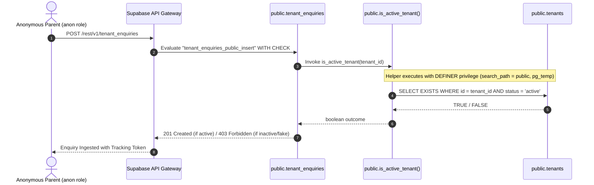

# KhelGrid SaaS Platform — Phase 1 Admissions Enquiry Security
## Public Ingestion Architecture, Token Tracking & CRM Privacy Controls

**Project:** `khelgrid-dotcom/khelgrid-platform`  
**Migration Reference:** [20261121200000_phase1_security_remediation_and_composite_keys.sql](file:///c:/Users/7khan/OneDrive/Desktop/Live%20score/supabase/migrations/20261121200000_phase1_security_remediation_and_composite_keys.sql)  
**TypeScript Client Reference:** [tenant-client.ts](file:///c:/Users/7khan/OneDrive/Desktop/Live%20score/src/integrations/supabase/tenant-client.ts)  

---

## 1. Vulnerability Analysis: The Anonymous Evaluation Failure (GAP-05)

KhelGrid enables unauthenticated parents visiting the public sports directory to submit free-trial and regular admissions enquiries directly into an academy's SaaS CRM queue.

In the initial migration `20261121160000`, the RLS policy on `public.tenant_enquiries` was:
```sql
CREATE POLICY "tenant_enquiries_public_insert"
  ON public.tenant_enquiries
  FOR INSERT
  TO anon, authenticated
  WITH CHECK (
    EXISTS (SELECT 1 FROM public.tenants WHERE id = tenant_id AND status = 'active')
  );
```

Simultaneously, least-privilege table grants revoked all access on `public.tenants` from anonymous callers:
```sql
REVOKE ALL ON public.tenants FROM PUBLIC, anon;
```

### The Ingestion Failure:
When an anonymous parent attempted to submit an enquiry, PostgREST evaluated the `WITH CHECK` expression under the `anon` PostgreSQL role. Because `anon` had no `SELECT` privilege on `public.tenants`, PostgreSQL aborted the transaction with:
```text
SQLSTATE 42501: permission denied for table tenants
Hint: Grant the required privileges to the current role with: GRANT SELECT ON public.tenants TO anon;
```

### The Insecure Temptation:
The naive fix suggested by PostgreSQL was:
`GRANT SELECT ON public.tenants TO anon;`
**This would have created a catastrophic security vulnerability**, exposing internal academy metadata, owner UUIDs, email contacts, and UPI VPAs to unauthenticated scrapers.

---

## 2. Remediated Architecture: The `is_active_tenant` Security Definer Helper

Phase 1 remediates this vulnerability without granting any table privileges on `public.tenants` to unauthenticated callers.

### Helper Function Implementation:
```sql
CREATE OR REPLACE FUNCTION public.is_active_tenant(p_tenant_id uuid)
RETURNS boolean
LANGUAGE sql
STABLE
SECURITY DEFINER
SET search_path = public, pg_temp
AS $$
  SELECT EXISTS (
    SELECT 1
    FROM public.tenants
    WHERE id = p_tenant_id
      AND status = 'active'
  );
$$;

-- Secure privilege grants
REVOKE ALL ON FUNCTION public.is_active_tenant(uuid) FROM PUBLIC;
GRANT EXECUTE ON FUNCTION public.is_active_tenant(uuid) TO anon, authenticated;
```

### Hardened RLS Policy on `tenant_enquiries`:
```sql
DROP POLICY IF EXISTS "tenant_enquiries_public_insert" ON public.tenant_enquiries;
CREATE POLICY "tenant_enquiries_public_insert"
  ON public.tenant_enquiries
  FOR INSERT
  TO anon, authenticated
  WITH CHECK (public.is_active_tenant(tenant_id));
```



---

## 3. Admissions Lead CRM Privacy Guarantees

1. **Write-Only Intake for Anonymous Callers**:
   `anon` possesses exclusively `INSERT` privileges on `public.tenant_enquiries`. `SELECT`, `UPDATE`, and `DELETE` remain strictly revoked. An unauthenticated caller cannot query back submitted enquiries, inspect other applicants, or enumerate candidate identities.
2. **Deterministic Token Tracking**:
   Each enquiry generates an authoritative `enquiry_token` (e.g. `ENQ-179526-7A9B`). This token allows the parent to receive a receipt confirmation without granting them read access to the database table.
3. **Tenant Boundary Enforcement for Staff**:
   Academy directors and coaches can only view enquiries belonging to their verified organization via:
   ```sql
   CREATE POLICY "tenant_enquiries_member_select"
     ON public.tenant_enquiries
     FOR SELECT
     TO authenticated
     USING (public.is_tenant_member(tenant_id));
   ```
4. **Data Sanitization & Age Restrictions**:
   The table enforces domain constraints preventing malformed submissions:
   - `CHECK (student_age IS NULL OR (student_age >= 3 AND student_age <= 70))`
   - `CHECK (request_type IN ('free_trial', 'regular_admission', 'scholarship_assessment'))`
   - `CHECK (char_length(enquiry_token) >= 6)`

---

## 4. TypeScript Client Implementation

In [tenant-client.ts](file:///c:/Users/7khan/OneDrive/Desktop/Live%20score/src/integrations/supabase/tenant-client.ts), the `submitTenantEnquiry` client adapter wraps public submission:

```typescript
export async function submitTenantEnquiry(enquiry: {
  tenantId: string
  enquiryToken?: string
  parentName: string
  parentPhone: string
  parentEmail?: string
  studentName: string
  studentAge?: number
  sport: string
  requestType: 'free_trial' | 'regular_admission' | 'scholarship_assessment'
  notes?: string
}): Promise<{ success: boolean; enquiryId?: string; enquiryToken?: string; message: string }> {
  const client = getSupabaseClient()
  if (!client) {
    return { success: false, message: 'Supabase client unconfigured' }
  }

  const token = enquiry.enquiryToken || `ENQ-${Date.now()}-${Math.random().toString(36).substring(2, 7).toUpperCase()}`

  try {
    const { data, error } = await client
      .from('tenant_enquiries')
      .insert({
        tenant_id: enquiry.tenantId,
        enquiry_token: token,
        parent_name: enquiry.parentName,
        parent_phone: enquiry.parentPhone,
        parent_email: enquiry.parentEmail || null,
        student_name: enquiry.studentName,
        student_age: enquiry.studentAge || null,
        sport: enquiry.sport,
        request_type: enquiry.requestType,
        notes: enquiry.notes || null,
        status: 'new',
      })
      .select('id, enquiry_token')
      .single()

    if (error) {
      return { success: false, message: error.message }
    }

    return {
      success: true,
      enquiryId: data.id,
      enquiryToken: data.enquiry_token,
      message: 'Enquiry submitted successfully',
    }
  } catch (err) {
    return { success: false, message: (err as Error).message }
  }
}
```

This guarantees seamless public admissions lead generation while preserving strict multi-tenant privacy.
