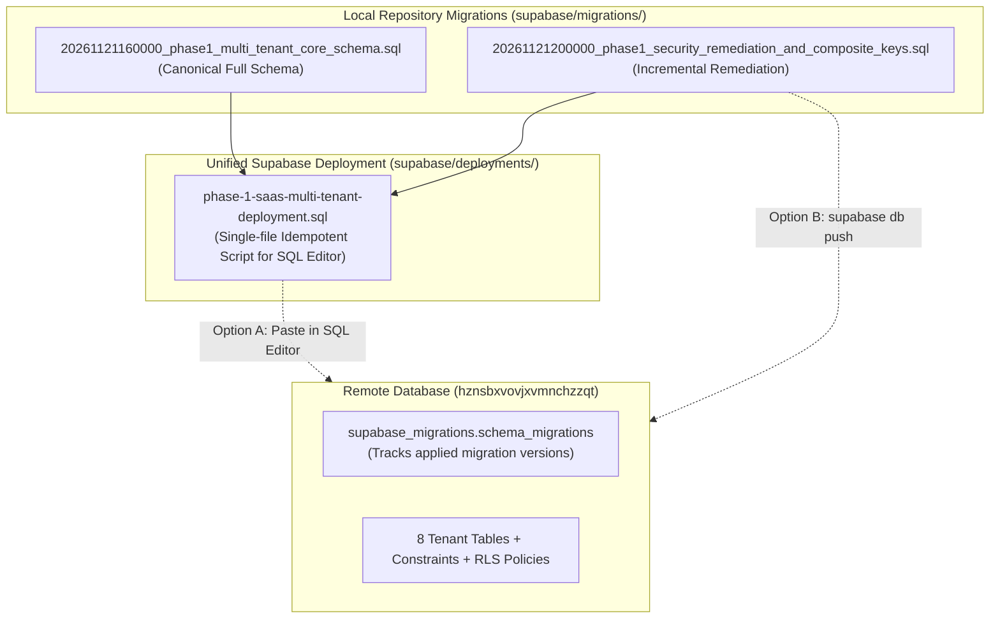

# KhelGrid SaaS Platform — Phase 1 Migration Reconciliation
## Schema Versioning, Remote State Alignment & Idempotent Deployment Protocol

**Project:** `khelgrid-dotcom/khelgrid-platform`  
**Target Database:** Development Supabase Project `hznsbxvovjxvmnchzzqt` (`https://hznsbxvovjxvmnchzzqt.supabase.co`)  
**Core Migration:** [20261121160000_phase1_multi_tenant_core_schema.sql](file:///c:/Users/7khan/OneDrive/Desktop/Live%20score/supabase/migrations/20261121160000_phase1_multi_tenant_core_schema.sql)  
**Remediation Migration:** [20261121200000_phase1_security_remediation_and_composite_keys.sql](file:///c:/Users/7khan/OneDrive/Desktop/Live%20score/supabase/migrations/20261121200000_phase1_security_remediation_and_composite_keys.sql)  
**Unified Deployment Script:** [phase-1-saas-multi-tenant-deployment.sql](file:///c:/Users/7khan/OneDrive/Desktop/Live%20score/supabase/deployments/phase-1-saas-multi-tenant-deployment.sql)  

---

## 1. Migration Hierarchy & Reconciliation Analysis (GAP-06)

To resolve **GAP-06** without using destructive operations (`DROP`, `TRUNCATE`, or table resets), Phase 1 structures migrations into a dual-path deployment architecture:



---

## 2. Remote Database Status on `hznsbxvovjxvmnchzzqt`

A direct API probe on the live Supabase development instance confirms the following state:

1. **Tables Live**:
   The 8 tenant tables exist on the database:
   - `public.tenants`
   - `public.tenant_memberships`
   - `public.tenant_batches`
   - `public.tenant_students`
   - `public.tenant_enquiries`
   - `public.tenant_fee_invoices`
   - `public.tenant_fee_transactions`
   - `public.tenant_attendance_events`
2. **Access Revocations Live**:
   All 8 tables return `42501: permission denied` for anonymous `SELECT`.
3. **Pending Remote Remediation**:
   - `public.provision_initial_tenant_owner()` returns `PGRST202: Could not find function in schema cache` (pending execution of `20261121200000`).
   - `public.is_active_tenant()` is pending execution of `20261121200000`.
   - Composite foreign keys `(tenant_id, ...)` are pending execution of `20261121200000`.

---

## 3. Idempotency Guarantees of the Remediation Migration

The remediation migration [20261121200000_phase1_security_remediation_and_composite_keys.sql](file:///c:/Users/7khan/OneDrive/Desktop/Live%20score/supabase/migrations/20261121200000_phase1_security_remediation_and_composite_keys.sql) is 100% idempotent and non-destructive:

1. **Conditional Constraint Dropping & Creation**:
   Foreign keys and unique constraints are inspected via `pg_constraint` catalog queries before modification:
   ```sql
   DO $$
   BEGIN
     IF EXISTS (SELECT 1 FROM pg_constraint WHERE conname = 'tenant_students_batch_id_fkey') THEN
       ALTER TABLE public.tenant_students DROP CONSTRAINT tenant_students_batch_id_fkey;
     END IF;
     IF NOT EXISTS (SELECT 1 FROM pg_constraint WHERE conname = 'fk_student_tenant_batch') THEN
       ALTER TABLE public.tenant_students
         ADD CONSTRAINT fk_student_tenant_batch
         FOREIGN KEY (tenant_id, batch_id)
         REFERENCES public.tenant_batches(tenant_id, id)
         ON DELETE SET NULL;
     END IF;
   END $$;
   ```
2. **Idempotent Policy Re-creation**:
   All policies use `DROP POLICY IF EXISTS ...` followed by `CREATE POLICY ...`.
3. **Idempotent Function Replacement**:
   Functions use `CREATE OR REPLACE FUNCTION ...`.
4. **Zero Data Loss**:
   No tables are dropped, truncated, or recreated. All 282 public academy listings and historical test records remain untouched.

---

## 4. Execution Instructions for Remote Database

### Option A: Via Supabase SQL Editor (Recommended)
1. Open the [Supabase SQL Editor](https://supabase.com/dashboard/project/hznsbxvovjxvmnchzzqt/sql).
2. Copy the entire contents of [20261121200000_phase1_security_remediation_and_composite_keys.sql](file:///c:/Users/7khan/OneDrive/Desktop/Live%20score/supabase/migrations/20261121200000_phase1_security_remediation_and_composite_keys.sql) (or the complete [phase-1-saas-multi-tenant-deployment.sql](file:///c:/Users/7khan/OneDrive/Desktop/Live%20score/supabase/deployments/phase-1-saas-multi-tenant-deployment.sql)).
3. Paste into the editor and click **Run**.
4. Confirm message: `Success. No rows returned.`

### Option B: Via Supabase CLI
```bash
npx supabase db push --remote="<pooler-connection-string>"
```

---

## 5. Post-Execution Verification SQL Queries

Run these queries in the Supabase SQL editor to confirm that all composite constraints and functions are active:

```sql
-- 1. Verify Composite Foreign Keys
SELECT conname, contype, pg_get_constraintdef(c.oid)
FROM pg_constraint c
JOIN pg_namespace n ON n.oid = c.connamespace
WHERE n.nspname = 'public'
  AND conname IN (
    'uq_tenant_batch',
    'uq_tenant_student',
    'uq_tenant_fee_invoice',
    'fk_student_tenant_batch',
    'fk_invoice_tenant_student',
    'fk_transaction_tenant_invoice',
    'fk_transaction_tenant_student',
    'fk_attendance_tenant_batch',
    'fk_attendance_tenant_student'
  );

-- 2. Verify Security Functions
SELECT proname, prosecdef, provolatile
FROM pg_proc p
JOIN pg_namespace n ON n.oid = p.pronamespace
WHERE n.nspname = 'public'
  AND proname IN (
    'is_tenant_member',
    'has_tenant_role',
    'is_active_tenant',
    'provision_initial_tenant_owner'
  );

-- 3. Verify Active Policies
SELECT tablename, policyname, cmd, roles
FROM pg_policies
WHERE schemaname = 'public'
  AND tablename LIKE 'tenant%'
ORDER BY tablename, policyname;
```

Expected result: 9 composite constraints present, 4 security functions active, and 14 granular RLS policies active.
