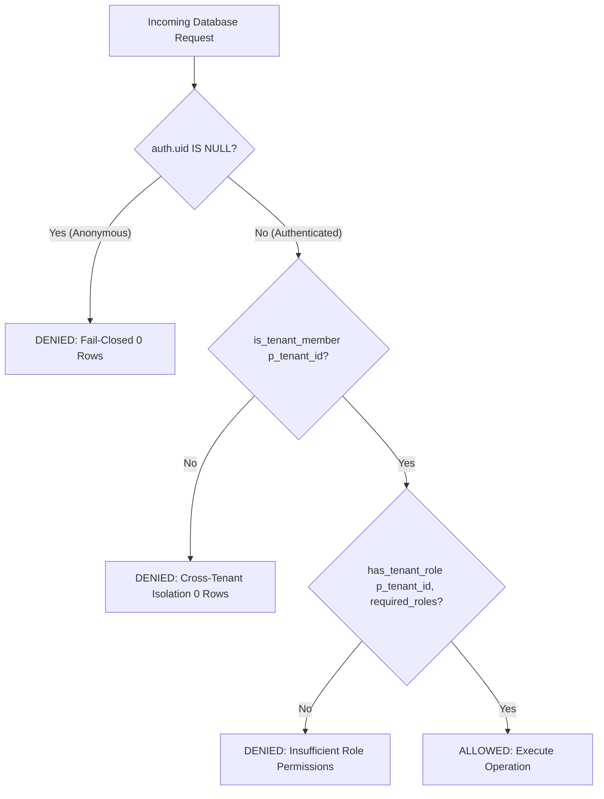

# KhelGrid SaaS Platform — Phase 1: Multi-Tenant Database Architecture

**Document Version:** 1.0  
**Target Environment:** Development Supabase Project `hznsbxvovjxvmnchzzqt`  
**Compliance Standard:** DPDP Act 2023 / Enterprise Multi-Tenant Isolation  

---

## 1. Architectural Philosophy: Directory vs. SaaS Workspace

A fundamental design law of KhelGrid is the **strict separation between Public Catalogue Listings and Customer SaaS Workspaces**:

```
+---------------------------------------------------------------------------------+
|                                 KHELGRID PLATFORM                               |
+---------------------------------------+-----------------------------------------+
|      PUBLIC DISCOVERY CATALOGUE       |         CUSTOMER SAAS WORKSPACE         |
|         (Read-Only / Free)            |         (Private / Multi-Tenant)        |
+---------------------------------------+-----------------------------------------+
|  Table: public.academies              |  Table: public.tenants                  |
|  - Free verified public listing       |  - Canonical business tenant (UUID)     |
|  - Searchable by sport, city, trials  |  - Private operational data boundary    |
|  - Visible to anonymous visitors      |  - Zero anonymous read access           |
|  - No SaaS operational privileges     |  - Governed by Tenant Memberships       |
+---------------------------------------+-----------------------------------------+
                                        | Optional 1:1 verified binding via       |
                                        | directory_entity_id                     |
                                        V
```

### Critical Rules
1. **Public Listing != SaaS Tenant:** An academy appearing in `public.academies` is **never** automatically treated as a SaaS customer or granted an owner.
2. **Onboarding & Verification Gate:** An operational tenant is only created when an authenticated user undergoes partner onboarding. A tenant may optionally link to a public listing (`directory_entity_id`) only after ownership verification.
3. **Fail-Closed Isolation:** If a user is not an active member of a tenant, they have zero SELECT, INSERT, UPDATE, or DELETE privileges on any of that tenant's records.

---

## 2. Core Relational Entities

### A. SaaS Tenants (`public.tenants`)
Canonical organization entity serving as the root tenant boundary:
- `id (uuid, PK)`: Immutable UUID identifier.
- `slug (text, UNIQUE)`: URL-friendly immutable alphanumeric slug.
- `name (text)`: Official organization name.
- `tenant_type (text)`: Organization category (`academy`, `coach`, `venue`, `tournament`).
- `status (text)`: Lifecycle state (`active`, `pending_verification`, `suspended`, `archived`).
- `owner_id (uuid, FK)`: Primary owner user ID referencing `auth.users(id)`.
- `directory_entity_id (uuid, FK)`: Optional reference to `public.academies(id)` or other catalogue entity, linked only upon verified claim.
- `contact_email`, `contact_phone`, `upi_vpa`: Validated operational metadata.
- `created_at`, `updated_at`: Audit timestamps.

### B. Tenant Memberships (`public.tenant_memberships`)
Links authenticated users to tenants with specific least-privilege roles:
- `id (uuid, PK)`: Membership record identifier.
- `tenant_id (uuid, FK)`: References `public.tenants(id)` ON DELETE CASCADE.
- `user_id (uuid, FK)`: References `auth.users(id)` ON DELETE CASCADE.
- `role (text)`: One of `owner`, `director`, `admin`, `head_coach`, `coach`, `accountant`, `front_desk`, `staff`, `parent`.
- `status (text)`: One of `active`, `invited`, `suspended`, `revoked`.
- `CONSTRAINT unique_tenant_user UNIQUE (tenant_id, user_id)`: Prevents duplicate membership records.

### C. Tenant Invitations (`public.tenant_invitations`)
Cryptographically secure invitation workflow:
- `id (uuid, PK)`: Invitation identifier.
- `tenant_id (uuid, FK)`: Target tenant.
- `email (text)`: Invitee email address.
- `role (text)`: Designated role.
- `token_hash (text, UNIQUE)`: 64-character SHA-256 hash of random token.
- `status (text)`: `pending`, `accepted`, `revoked`, `expired`.
- `expires_at (timestamptz)`: 7-day expiration window.

---

## 3. Scoped Operational Data & Composite Foreign Key Integrity

To guarantee that records belonging to Tenant A can **never** accidentally reference records belonging to Tenant B, tables utilize composite foreign keys:

```sql
-- Batches define unique tenant constraint
CONSTRAINT uq_tenant_batch UNIQUE (tenant_id, id)

-- Students reference both tenant_id and batch_id
CONSTRAINT fk_student_batch FOREIGN KEY (tenant_id, batch_id)
  REFERENCES public.tenant_batches (tenant_id, id) ON DELETE SET NULL

-- Attendance references tenant_id, batch_id, and student_id
CONSTRAINT fk_attendance_batch FOREIGN KEY (tenant_id, batch_id)
  REFERENCES public.tenant_batches (tenant_id, id) ON DELETE CASCADE
CONSTRAINT fk_attendance_student FOREIGN KEY (tenant_id, student_id)
  REFERENCES public.tenant_students (tenant_id, id) ON DELETE CASCADE
```

This structural constraint ensures that even if application logic were compromised, PostgreSQL's foreign key engine physically prevents cross-tenant data linkage.

---

## 4. Tenant Ownership & Role Escalation Defense

1. **Sole Owner Protection:** A tenant's sole owner cannot demote themselves or be deactivated. Demotion requires an explicit ownership transfer protocol or a co-owner.
2. **No Client-Side Role Elevation:** Client requests passing a role in headers or JSON body are ignored. Roles are strictly evaluated by querying `public.tenant_memberships` using `auth.uid()`.
3. **Immutable Tenant Reassignment Prevention:**
   - Triggers or RLS `WITH CHECK` clauses block updating `tenant_id` on any operational record once inserted.
   - A student, batch, or invoice cannot be moved to another tenant by editing the `tenant_id` field.

---

## 5. Row Level Security (RLS) Policy Architecture

All tenant tables enforce Row Level Security (`ALTER TABLE ... ENABLE ROW LEVEL SECURITY;`).



### Authorization Functions
- `public.is_tenant_member(p_tenant_id uuid)`:
  Returns `true` if `auth.uid()` has an active membership in `p_tenant_id`. `SECURITY DEFINER`, `SET search_path = public, pg_temp`.
- `public.has_tenant_role(p_tenant_id uuid, p_roles text[])`:
  Returns `true` if `auth.uid()` has an active membership matching one of `p_roles`. `SECURITY DEFINER`, `SET search_path = public, pg_temp`.

Both functions are revoked from `PUBLIC` and granted strictly to `authenticated`.
