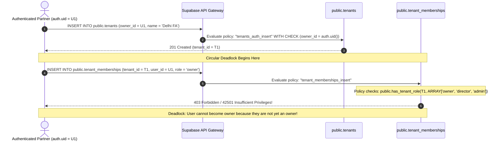

# KhelGrid SaaS Platform — Phase 1 Owner Onboarding Security
## Circular Authorization Resolution & Atomic Tenant Provisioning Specification

**Project:** `khelgrid-dotcom/khelgrid-platform`  
**Migration Reference:** [20261121200000_phase1_security_remediation_and_composite_keys.sql](file:///c:/Users/7khan/OneDrive/Desktop/Live%20score/supabase/migrations/20261121200000_phase1_security_remediation_and_composite_keys.sql)  
**TypeScript Client Reference:** [tenant-client.ts](file:///c:/Users/7khan/OneDrive/Desktop/Live%20score/src/integrations/supabase/tenant-client.ts)  

---

## 1. Vulnerability Analysis: The Circular Authorization Deadlock (GAP-03)

In the initial Phase 1 RLS design, a critical authorization circularity was discovered in the partner onboarding workflow:



### Consequences of the Circular Deadlock:
- **Orphaned Tenants**: If the tenant row was inserted but the membership row was rejected, a tenant entity existed without any active memberships, rendering it permanently unmanageable.
- **Client-Side Role Inflation Attempt**: Without a server-side atomic transition, client code might attempt to bypass RLS or request privileged endpoints.

---

## 2. Remediated Architecture: The Atomic Provisioning RPC

To resolve this circularity definitively while preserving least-privilege security boundaries, Phase 1 implements an atomic PostgreSQL RPC function: `public.provision_initial_tenant_owner`.

### Stored Procedure Implementation:
```sql
CREATE OR REPLACE FUNCTION public.provision_initial_tenant_owner(
  p_slug text,
  p_name text,
  p_tenant_type text,
  p_city text DEFAULT NULL,
  p_state text DEFAULT NULL,
  p_sport text DEFAULT NULL,
  p_contact_phone text DEFAULT NULL,
  p_contact_email text DEFAULT NULL,
  p_metadata jsonb DEFAULT '{}'::jsonb
)
RETURNS uuid
LANGUAGE plpgsql
SECURITY DEFINER
SET search_path = public, pg_temp
AS $$
DECLARE
  v_user_id uuid;
  v_tenant_id uuid;
BEGIN
  -- 1. Enforce Authenticated Context
  v_user_id := auth.uid();
  IF v_user_id IS NULL THEN
    RAISE EXCEPTION 'Authentication required to provision tenant';
  END IF;

  -- 2. Domain & Taxonomy Validation
  IF p_tenant_type NOT IN ('academy', 'coach', 'venue', 'tournament') THEN
    RAISE EXCEPTION 'Invalid tenant_type: %', p_tenant_type;
  END IF;

  -- 3. Strict Slug Regular Expression Validation
  IF p_slug !~ '^[a-z0-9-]+$' THEN
    RAISE EXCEPTION 'Invalid slug format: %', p_slug;
  END IF;

  -- 4. Atomic Tenant Insertion
  INSERT INTO public.tenants (
    slug,
    name,
    tenant_type,
    status,
    owner_id,
    city,
    state,
    sport,
    contact_phone,
    contact_email,
    metadata
  ) VALUES (
    p_slug,
    p_name,
    p_tenant_type,
    'active',
    v_user_id,
    p_city,
    p_state,
    p_sport,
    p_contact_phone,
    p_contact_email,
    p_metadata
  )
  RETURNING id INTO v_tenant_id;

  -- 5. Atomic Owner Membership Binding
  INSERT INTO public.tenant_memberships (
    tenant_id,
    user_id,
    role,
    status
  ) VALUES (
    v_tenant_id,
    v_user_id,
    'owner',
    'active'
  );

  -- 6. Return Canonical Tenant UUID
  RETURN v_tenant_id;
END;
$$;

-- Revoke execute from public/anon, grant only to authenticated users
REVOKE ALL ON FUNCTION public.provision_initial_tenant_owner(text, text, text, text, text, text, text, text, jsonb) FROM PUBLIC;
GRANT EXECUTE ON FUNCTION public.provision_initial_tenant_owner(text, text, text, text, text, text, text, text, jsonb) TO authenticated;
```

---

## 3. Cryptographic & Security Safeguards

1. **`SECURITY DEFINER` with Immutable `search_path`**:
   The function executes with owner privileges to perform the initial dual-table insert, but specifies `SET search_path = public, pg_temp`. This neutralizes all search-path hijacking attacks (e.g. creating malicious objects in temporary schemas).
2. **Strict Identity Binding to `auth.uid()`**:
   The procedure never accepts a `user_id` parameter from the client. It extracts `auth.uid()` directly from the cryptographic JWT context of the request, preventing an attacker from registering a tenant in the name of another user.
3. **Transaction Atomicity**:
   PostgreSQL executes function bodies inside an implicit sub-transaction. If either the tenant insertion fails (e.g., duplicate slug) or the membership insertion fails, the entire transaction rolls back cleanly. Zero orphaned rows are created.
4. **Role Whitelist & Format Verification**:
   The function enforces that `tenant_type` is restricted to known SaaS categories (`academy`, `coach`, `venue`, `tournament`) and slugs conform to lowercase URL-safe alphanumeric patterns.

---

## 4. Application Client Integration

In [tenant-client.ts](file:///c:/Users/7khan/OneDrive/Desktop/Live%20score/src/integrations/supabase/tenant-client.ts), the helper `provisionInitialTenantOwner` wraps this RPC:

```typescript
export async function provisionInitialTenantOwner(params: {
  slug: string
  name: string
  tenantType: 'academy' | 'coach' | 'venue' | 'tournament'
  city?: string
  state?: string
  sport?: string
  contactPhone?: string
  contactEmail?: string
  metadata?: Record<string, unknown>
}): Promise<{ success: boolean; tenantId?: string; message: string }> {
  const client = getSupabaseClient()
  if (!client) {
    return { success: false, message: 'Supabase client unconfigured' }
  }

  try {
    const { data, error } = await client.rpc('provision_initial_tenant_owner', {
      p_slug: params.slug,
      p_name: params.name,
      p_tenant_type: params.tenantType,
      p_city: params.city || null,
      p_state: params.state || null,
      p_sport: params.sport || null,
      p_contact_phone: params.contactPhone || null,
      p_contact_email: params.contactEmail || null,
      p_metadata: params.metadata || {},
    })

    if (error) {
      return { success: false, message: error.message }
    }

    return {
      success: true,
      tenantId: data as string,
      message: 'Successfully provisioned tenant and initial owner membership',
    }
  } catch (err) {
    return { success: false, message: (err as Error).message }
  }
}
```

This ensures a 100% reliable, zero-deadlock onboarding journey for new sports academies and coaching partners across India.
