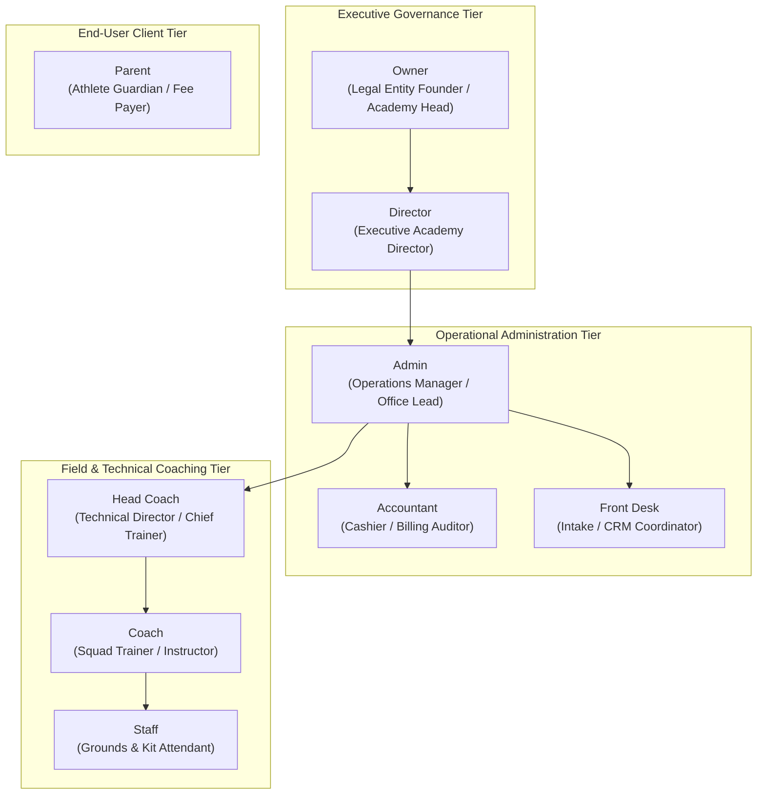

# KhelGrid SaaS Platform — Phase 1 Role Transition Matrix
## RBAC Permission Boundaries, Role Ceilings & Privilege Escalation Defenses

**Project:** `khelgrid-dotcom/khelgrid-platform`  
**Migration Reference:** [20261121200000_phase1_security_remediation_and_composite_keys.sql](../../supabase/migrations/20261121200000_phase1_security_remediation_and_composite_keys.sql)  
**Schema Reference:** [20261121160000_phase1_multi_tenant_core_schema.sql](../../supabase/migrations/20261121160000_phase1_multi_tenant_core_schema.sql)  

---

## 1. Multi-Tenant Role Hierarchy

Phase 1 defines 9 operational roles across sports infrastructure management:



---

## 2. Role Transition Permission Matrix (Who Can Manage Whom)

To prevent **GAP-04** (privilege escalation where an operational admin or coach elevates their privileges or modifies another member's role), the matrix below is enforced directly in PostgreSQL RLS policies:

| Target Role | Can Be Invited By (`INSERT`) | Can Be Modified By (`UPDATE`) | Can Be Deleted By (`DELETE`) |
| :--- | :--- | :--- | :--- |
| **`owner`** | Canonical Registration RPC Only | Owner Only | Cannot be deleted (Transfer required) |
| **`director`** | Owner, Director | Owner, Director | Owner Only |
| **`admin`** | Owner, Director | Owner, Director | Owner, Director |
| **`head_coach`** | Owner, Director, Admin | Owner, Director, Admin | Owner, Director, Admin |
| **`coach`** | Owner, Director, Admin | Owner, Director, Admin | Owner, Director, Admin |
| **`accountant`** | Owner, Director, Admin | Owner, Director, Admin | Owner, Director, Admin |
| **`front_desk`** | Owner, Director, Admin | Owner, Director, Admin | Owner, Director, Admin |
| **`staff`** | Owner, Director, Admin | Owner, Director, Admin | Owner, Director, Admin |
| **`parent`** | Owner, Director, Admin, Front Desk | Owner, Director, Admin | Owner, Director, Admin, Self |

---

## 3. Mandatory Defense-in-Depth Security Rules

### Rule 1: Anti-Self-Modification (`user_id != auth.uid()`)
A member cannot alter their own role, membership status, or privileges via client-facing `UPDATE` operations. If an admin attempts to update their own role from `admin` to `owner`, the policy check `user_id != auth.uid()` evaluates to `FALSE` and PostgreSQL rejects the write.

### Rule 2: Administrative Role Ceiling
An `admin` has operational authority over staff, coaches, and front-desk personnel, but has an absolute ceiling:
- An admin cannot invite an `owner` or `director`.
- An admin cannot update an `owner` or `director`.
- An admin cannot promote any member to `owner` or `director`.
- An admin cannot delete an `owner`, `director`, or peer `admin`.

### Rule 3: Voluntary Departure
Any non-owner member can voluntarily resign / leave a tenant organization by executing `DELETE ON public.tenant_memberships WHERE user_id = auth.uid() AND role != 'owner'`. Owners cannot leave without first transferring ownership to another active member.

---

## 4. PostgreSQL RLS Policy Implementation

The following granular policies in [20261121200000_phase1_security_remediation_and_composite_keys.sql](../../supabase/migrations/20261121200000_phase1_security_remediation_and_composite_keys.sql) enforce these boundaries:

```sql
-- 1. Fine-Grained INSERT Policy
CREATE POLICY "tenant_memberships_insert"
  ON public.tenant_memberships
  FOR INSERT
  TO authenticated
  WITH CHECK (
    -- Owner and Director can invite any role
    (public.has_tenant_role(tenant_id, ARRAY['owner', 'director'])) OR
    -- Admin can invite staff, coaches, etc. but NEVER owner or director
    (public.has_tenant_role(tenant_id, ARRAY['admin']) AND role NOT IN ('owner', 'director'))
  );

-- 2. Fine-Grained UPDATE Policy with Anti-Self-Promotion
CREATE POLICY "tenant_memberships_update"
  ON public.tenant_memberships
  FOR UPDATE
  TO authenticated
  USING (
    -- Actor must be privileged member of the tenant
    public.has_tenant_role(tenant_id, ARRAY['owner', 'director', 'admin'])
  )
  WITH CHECK (
    -- Rule 1: Cannot change own role/status (anti-self-promotion)
    user_id != auth.uid() AND
    (
      -- Rule 2: Only Owner can modify/reassign Owner
      (public.has_tenant_role(tenant_id, ARRAY['owner'])) OR
      -- Rule 3: Director can update any role except Owner, cannot promote to Owner
      (public.has_tenant_role(tenant_id, ARRAY['director']) AND role != 'owner') OR
      -- Rule 4: Admin cannot modify or elevate to Owner or Director
      (public.has_tenant_role(tenant_id, ARRAY['admin']) AND role NOT IN ('owner', 'director'))
    )
  );

-- 3. Fine-Grained DELETE Policy
CREATE POLICY "tenant_memberships_delete"
  ON public.tenant_memberships
  FOR DELETE
  TO authenticated
  USING (
    -- Voluntary departure (non-owner only)
    (user_id = auth.uid() AND role != 'owner') OR
    -- Owner can remove any non-owner member
    (public.has_tenant_role(tenant_id, ARRAY['owner']) AND role != 'owner') OR
    -- Director can remove operational staff (not owner/director)
    (public.has_tenant_role(tenant_id, ARRAY['director']) AND role NOT IN ('owner', 'director')) OR
    -- Admin can remove operational staff (not owner/director/admin)
    (public.has_tenant_role(tenant_id, ARRAY['admin']) AND role NOT IN ('owner', 'director', 'admin'))
  );
```

These policies provide full protection against vertical and lateral privilege escalation.
