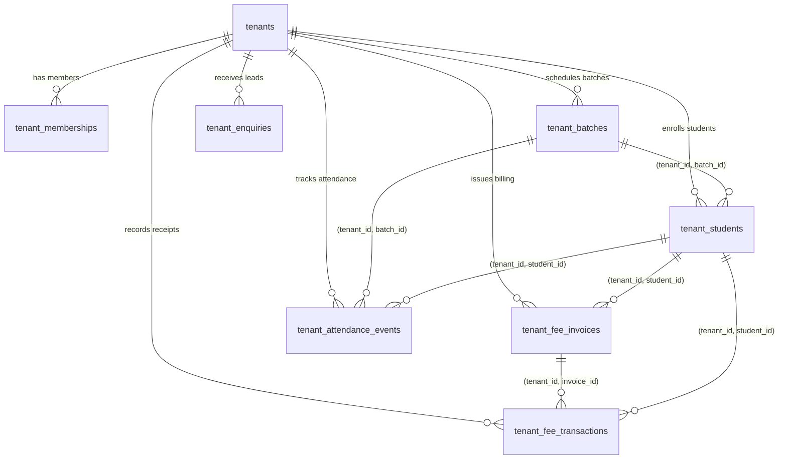

# KhelGrid SaaS Platform — Phase 1 Tenant Relationship Matrix
## Composite Foreign Key Architecture & Relational Isolation Specification

**Project:** `khelgrid-dotcom/khelgrid-platform`  
**Migration Reference:** [20261121200000_phase1_security_remediation_and_composite_keys.sql](../../supabase/migrations/20261121200000_phase1_security_remediation_and_composite_keys.sql)  
**Schema Definition:** [20261121160000_phase1_multi_tenant_core_schema.sql](../../supabase/migrations/20261121160000_phase1_multi_tenant_core_schema.sql)  

---

## 1. Relational Entity Architecture

Phase 1 establishes a strict hierarchical multi-tenant data model. To eliminate **GAP-02** (cross-tenant entity linking vulnerability), every child entity maintains an immutable `tenant_id` column and references its parent entity via a **composite foreign key** `(tenant_id, parent_id)`.



---

## 2. Table-by-Table Relational Schema & Constraints

### 2.1 `public.tenants` (Root Tenant Entity)
Canonical organizational entity representing an academy, coach organization, venue operator, or tournament host.

| Column | Type | Nullable | Default | Constraints & Checks |
| :--- | :--- | :---: | :--- | :--- |
| `id` | `uuid` | No | `gen_random_uuid()` | **PRIMARY KEY** |
| `slug` | `text` | No | | **UNIQUE**, format `^[a-z0-9-]+$` |
| `name` | `text` | No | | Min length 2 characters |
| `tenant_type` | `text` | No | | `IN ('academy', 'coach', 'venue', 'tournament')` |
| `status` | `text` | No | `'active'` | `IN ('active', 'pending_verification', 'suspended', 'archived')` |
| `owner_id` | `uuid` | Yes | | `REFERENCES auth.users(id) ON DELETE RESTRICT` |
| `city` | `text` | Yes | | Free-text city |
| `state` | `text` | Yes | | Free-text state |
| `sport` | `text` | Yes | | Primary sport discipline |
| `contact_phone` | `text` | Yes | | Contact phone number |
| `contact_email` | `text` | Yes | | Contact email address |
| `upi_vpa` | `text` | Yes | | VPA format check `^.+@[a-zA-Z0-9.-]+$` |
| `metadata` | `jsonb` | No | `'{}'::jsonb` | Unstructured organizational metadata |
| `created_at` | `timestamptz` | No | `now()` | Audit timestamp |
| `updated_at` | `timestamptz` | No | `now()` | Audit timestamp |

---

### 2.2 `public.tenant_memberships` (Identity & Role Bindings)
Associates authenticated users with an organization and assigns an operational role.

| Column | Type | Nullable | Default | Constraints & Checks |
| :--- | :--- | :---: | :--- | :--- |
| `id` | `uuid` | No | `gen_random_uuid()` | **PRIMARY KEY** |
| `tenant_id` | `uuid` | No | | `REFERENCES public.tenants(id) ON DELETE CASCADE` |
| `user_id` | `uuid` | Yes | | `REFERENCES auth.users(id) ON DELETE CASCADE` |
| `role` | `text` | No | | `IN ('owner', 'director', 'admin', 'head_coach', 'coach', 'accountant', 'front_desk', 'staff', 'parent')` |
| `status` | `text` | No | `'active'` | `IN ('active', 'invited', 'suspended', 'revoked')` |
| `invited_email`| `text` | Yes | | Email format validation regex |
| `invited_by` | `uuid` | Yes | | `REFERENCES auth.users(id) ON DELETE SET NULL` |
| `created_at` | `timestamptz` | No | `now()` | Audit timestamp |
| `updated_at` | `timestamptz` | No | `now()` | Audit timestamp |
| **Unique** | `(tenant_id, user_id)` | | | `CONSTRAINT unique_tenant_user UNIQUE (tenant_id, user_id)` |

---

### 2.3 `public.tenant_batches` (Coaching Squads & Schedules)

| Column | Type | Nullable | Default | Constraints & Checks |
| :--- | :--- | :---: | :--- | :--- |
| `id` | `uuid` | No | `gen_random_uuid()` | **PRIMARY KEY** |
| `tenant_id` | `uuid` | No | | `REFERENCES public.tenants(id) ON DELETE CASCADE` |
| `batch_name` | `text` | No | | Min length 2 characters |
| `sport` | `text` | No | | Coaching discipline |
| `days` | `text` | No | | Operating days (e.g. `'Mon, Wed, Fri'`) |
| `timings` | `text` | No | | Operating time slot (e.g. `'06:00 AM – 08:00 AM'`) |
| `coach_name` | `text` | Yes | | Assigned coach display name |
| `age_group` | `text` | Yes | | Target age bracket (e.g. `'U-14'`) |
| `monthly_fee` | `integer` | No | `0` | Fee in INR (`CHECK monthly_fee >= 0`) |
| `max_capacity`| `integer` | No | `25` | Maximum squad size (`CHECK max_capacity > 0`) |
| `is_active` | `boolean` | No | `true` | Schedule active flag |
| `created_at` | `timestamptz` | No | `now()` | Audit timestamp |
| **Unique 1** | `(tenant_id, batch_name)`| | | `CONSTRAINT unique_batch_per_tenant UNIQUE` |
| **Unique 2** | `(tenant_id, id)` | | | `CONSTRAINT uq_tenant_batch UNIQUE` (Target for composite FKs) |

---

### 2.4 `public.tenant_students` (Trainee Roster)

| Column | Type | Nullable | Default | Constraints & Composite FKs |
| :--- | :--- | :---: | :--- | :--- |
| `id` | `uuid` | No | `gen_random_uuid()` | **PRIMARY KEY** |
| `tenant_id` | `uuid` | No | | `REFERENCES public.tenants(id) ON DELETE CASCADE` |
| `batch_id` | `uuid` | Yes | | `CONSTRAINT fk_student_tenant_batch FOREIGN KEY (tenant_id, batch_id) REFERENCES public.tenant_batches(tenant_id, id) ON DELETE SET NULL` |
| `student_name`| `text` | No | | Trainee full name |
| `parent_name` | `text` | No | | Guardian primary contact |
| `parent_phone`| `text` | No | | Guardian mobile number |
| `parent_email`| `text` | Yes | | Guardian email |
| `guardian_user_id` | `uuid` | Yes | | `REFERENCES auth.users(id) ON DELETE SET NULL` |
| `date_of_birth`| `date` | Yes | | Athlete DOB |
| `monthly_fee` | `integer` | No | `0` | Monthly fee in INR |
| `fee_status` | `text` | No | `'due_soon'` | `IN ('paid', 'due_soon', 'overdue', 'exempt')` |
| `is_active` | `boolean` | No | `true` | Student active status |
| **Unique** | `(tenant_id, id)` | | | `CONSTRAINT uq_tenant_student UNIQUE` (Target for composite FKs) |

---

### 2.5 `public.tenant_enquiries` (Admissions CRM Leads)

| Column | Type | Nullable | Default | Constraints & Checks |
| :--- | :--- | :---: | :--- | :--- |
| `id` | `uuid` | No | `gen_random_uuid()` | **PRIMARY KEY** |
| `tenant_id` | `uuid` | No | | `REFERENCES public.tenants(id) ON DELETE CASCADE` |
| `enquiry_token`| `text` | No | | **UNIQUE**, format `char_length >= 6` |
| `parent_name` | `text` | No | | Lead contact name |
| `parent_phone`| `text` | No | | Lead contact phone |
| `parent_email`| `text` | Yes | | Lead contact email |
| `student_name`| `text` | No | | Prospective trainee name |
| `student_age` | `integer` | Yes | | Age bracket check `(>= 3 AND <= 70)` |
| `sport` | `text` | No | | Sport discipline |
| `request_type`| `text` | No | | `IN ('free_trial', 'regular_admission', 'scholarship_assessment')` |
| `status` | `text` | No | `'new'` | `IN ('new', 'contacted', 'trial_scheduled', 'enrolled', 'archived')` |
| `submitted_at`| `timestamptz` | No | `now()` | Ingestion timestamp |

---

### 2.6 `public.tenant_fee_invoices` (Billing Records)

| Column | Type | Nullable | Default | Constraints & Composite FKs |
| :--- | :--- | :---: | :--- | :--- |
| `id` | `uuid` | No | `gen_random_uuid()` | **PRIMARY KEY** |
| `tenant_id` | `uuid` | No | | `REFERENCES public.tenants(id) ON DELETE CASCADE` |
| `student_id` | `uuid` | No | | `CONSTRAINT fk_invoice_tenant_student FOREIGN KEY (tenant_id, student_id) REFERENCES public.tenant_students(tenant_id, id) ON DELETE RESTRICT` |
| `invoice_number` | `text` | No | | **UNIQUE** within database |
| `amount` | `integer` | No | | Amount in INR (`CHECK amount >= 0`) |
| `billing_month` | `text` | No | | e.g. `'November 2026'` |
| `due_date` | `date` | No | | Payment deadline |
| `status` | `text` | No | `'issued'` | `IN ('draft', 'issued', 'paid', 'partially_paid', 'cancelled', 'refunded')` |
| **Unique** | `(tenant_id, id)` | | | `CONSTRAINT uq_tenant_fee_invoice UNIQUE` |

---

### 2.7 `public.tenant_fee_transactions` (Immutable Ledger Receipts)

| Column | Type | Nullable | Default | Constraints & Composite FKs |
| :--- | :--- | :---: | :--- | :--- |
| `id` | `uuid` | No | `gen_random_uuid()` | **PRIMARY KEY** |
| `tenant_id` | `uuid` | No | | `REFERENCES public.tenants(id) ON DELETE CASCADE` |
| `invoice_id` | `uuid` | Yes | | `CONSTRAINT fk_transaction_tenant_invoice FOREIGN KEY (tenant_id, invoice_id) REFERENCES public.tenant_fee_invoices(tenant_id, id) ON DELETE RESTRICT` |
| `student_id` | `uuid` | No | | `CONSTRAINT fk_transaction_tenant_student FOREIGN KEY (tenant_id, student_id) REFERENCES public.tenant_students(tenant_id, id) ON DELETE RESTRICT` |
| `receipt_number` | `text` | No | | **UNIQUE** authoritative receipt identifier |
| `amount` | `integer` | No | | Paid amount in INR (`CHECK amount > 0`) |
| `payment_mode` | `text` | No | | `IN ('cash', 'direct_upi', 'bank_transfer', 'cheque')` |
| `collected_by_name` | `text` | No | | Staff display name at collection |
| `collected_date` | `date` | No | `CURRENT_DATE` | Physical receipt date |
| `status` | `text` | No | `'cash_in_hand'` | `IN ('settled', 'cash_in_hand', 'refunded')` |

---

### 2.8 `public.tenant_attendance_events` (Daily Pitch-Side Roll-Call)

| Column | Type | Nullable | Default | Constraints & Composite FKs |
| :--- | :--- | :---: | :--- | :--- |
| `id` | `uuid` | No | `gen_random_uuid()` | **PRIMARY KEY** |
| `tenant_id` | `uuid` | No | | `REFERENCES public.tenants(id) ON DELETE CASCADE` |
| `batch_id` | `uuid` | No | | `CONSTRAINT fk_attendance_tenant_batch FOREIGN KEY (tenant_id, batch_id) REFERENCES public.tenant_batches(tenant_id, id) ON DELETE CASCADE` |
| `student_id` | `uuid` | No | | `CONSTRAINT fk_attendance_tenant_student FOREIGN KEY (tenant_id, student_id) REFERENCES public.tenant_students(tenant_id, id) ON DELETE CASCADE` |
| `session_date` | `date` | No | `CURRENT_DATE` | Calendar date of training |
| `check_in_time`| `timestamptz` | Yes | | Timestamp of physical check-in |
| `status` | `text` | No | | `IN ('present', 'absent', 'excused')` |
| `marked_by` | `uuid` | Yes | | `REFERENCES auth.users(id) ON DELETE SET NULL` |
| `marked_at` | `timestamptz` | No | `now()` | Roll-call execution time |
| **Unique** | `(tenant_id, batch_id, student_id, session_date)` | | | `CONSTRAINT unique_attendance_session UNIQUE` |

---

## 3. Covering Indexes for High-Velocity Queries

To ensure zero index scans or cross-tenant leaks during join operations, covering composite indexes are deployed:

```sql
CREATE INDEX idx_tenant_batches_tenant ON public.tenant_batches(tenant_id, is_active);
CREATE INDEX idx_tenant_students_composite ON public.tenant_students(tenant_id, batch_id);
CREATE INDEX idx_tenant_students_guardian ON public.tenant_students(guardian_user_id);
CREATE INDEX idx_tenant_enquiries_tenant_status ON public.tenant_enquiries(tenant_id, status);
CREATE INDEX idx_tenant_fee_invoices_composite ON public.tenant_fee_invoices(tenant_id, student_id);
CREATE INDEX idx_tenant_fee_tx_composite ON public.tenant_fee_transactions(tenant_id, invoice_id, student_id);
CREATE INDEX idx_tenant_attendance_composite ON public.tenant_attendance_events(tenant_id, batch_id, student_id);
```

This composite relationship architecture ensures that cross-tenant contamination is mathematically impossible at the database storage engine layer.
