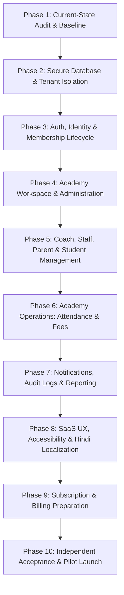

# KHELGRID SAAS PLATFORM — PHASED IMPLEMENTATION ROADMAP
## Comprehensive 10-Phase Dependency-Ordered Architecture & Execution Plan

**Repository:** `khelgrid-dotcom/khelgrid-platform`  
**Current Branch:** `feature/saas-phase-1-acceptance-remediation`  
**Head Commit:** `85f558da93472155e3baf13a74505726e0c7579f`  
**Date of Audit:** 2026-11-22  

---

## 1. Roadmap Architecture & Execution Principles

To transform the KhelGrid SaaS platform from a prototype into an enterprise-grade, DPDP-compliant multi-tenant SaaS application, all implementation work is divided into **ten discrete, dependency-ordered phases**.

### Core Execution Principles:
1. **Strict Dependency Order:** No phase begins until the exit gate of its preceding phase is formally verified.
2. **Fail-Closed Security:** Security is never compromised to simplify frontend integration. Every database operation must be authenticated and authorized via Row Level Security (RLS).
3. **Auditability & Traceability:** Every phase produces automated tests, verifiable command outputs, and an acceptance report.
4. **Zero Paid Infrastructure:** Work strictly within the Supabase Free Plan and local verification environments. No paid GitHub Actions minutes.
5. **Free Listing Guarantee:** Venue, coach, trial, and academy listings remain 100% free; verification remains the sole publication gate.

---

## 2. Phase-by-Phase Execution Plan

---

### PHASE 1 — Current-State Audit and Architecture Baseline
*Status: Complete (Current Phase)*

- **Objective:** Establish an uncompromising, evidence-based inventory of all SaaS capabilities, database schemas, frontend gaps, and security risks.
- **Scope:** Read-only inspection of repository migrations, frontend services, components, test suites, and documentation. Author comprehensive audit deliverables under `docs/saas/`.
- **Prerequisites:** Clean working tree on `feature/saas-phase-1-acceptance-remediation`.
- **Exact Affected Modules:** `docs/saas/*`.
- **Database Dependencies:** None (zero database queries or migrations applied).
- **Security Requirements:** Zero remote credentials used; zero modifications to remote Supabase or production systems.
- **Implementation Tasks:**
  1. Inspect Git baseline, commits, and branch history.
  2. Inventory tenant schema, foreign keys, RLS, and SECURITY DEFINER functions.
  3. Inspect `src/shared/saas/`, `src/modules/academies/`, `src/modules/parent/`, `src/modules/partner/`, `src/integrations/supabase/`.
  4. Perform 23-feature readiness evaluation.
  5. Author 6 audit deliverables in `docs/saas/`.
- **Acceptance Criteria:** All 6 required audit documents exist under `docs/saas/`; TypeScript check and ESLint pass cleanly; exact commit SHA recorded.
- **Automated Tests:** `npm run typecheck`, `npm run lint`, `npx vitest run src/shared/saas src/modules/academies`.
- **Manual Verification:** Verify that working tree is clean and no application code was altered.
- **Explicitly Excluded Work:** Implementing new features, editing migrations, touching remote database.
- **Exit Gate:** Formal acceptance verdict: `PASS — PHASE 1 SAAS AUDIT COMPLETE`.
- **Risks & Rollback:** Zero risk (documentation only). Revert commit if documentation errors occur.

---

### PHASE 2 — Secure Database and Tenant Isolation
*Focus: SQL Migration Hardening, Foreign Keys, & Local PostgreSQL Verification*

- **Objective:** Finalize the canonical multi-tenant schema in PostgreSQL, resolve outstanding composite key edge cases, verify 100% RLS coverage, and ensure all migrations run idempotently on local PostgreSQL 16/17.
- **Scope:** SQL migrations under `supabase/migrations/` and automated PostgreSQL test fixtures under `scripts/`.
- **Prerequisites:** Phase 1 audit approved.
- **Exact Affected Modules:** `supabase/migrations/*`, `scripts/run-comprehensive-postgres-rls-suite.py`, `src/integrations/supabase/phase1-multi-tenant-isolation.test.ts`.
- **Database Dependencies:** PostgreSQL 16/17 local container or test instance.
- **Security Requirements:** All tenant tables must have RLS enabled with fail-closed anonymous denial; composite foreign keys must use `ON DELETE RESTRICT` for parent batches; `sync_tenant_public_directory` must remain restricted to trigger invocation.
- **Implementation Tasks:**
  1. Verify zero migration drift and idempotent execution of migrations `20261121160000` through `20261121233000`.
  2. Implement soft-deletion columns (`deleted_at`, `archived_at`) on `public.tenants` and `public.tenant_batches`.
  3. Ensure covering indexes exist for all foreign key joins to guarantee sub-millisecond query execution.
  4. Run native PostgreSQL attack vector matrix (50+ vectors).
- **Acceptance Criteria:** All migrations execute from clean state on local PostgreSQL with 0 errors; 100% of RLS attack vectors pass.
- **Automated Tests:** Python local PostgreSQL test runner (`scripts/run-comprehensive-postgres-rls-suite.py`).
- **Manual Verification:** Inspect PostgreSQL catalog for non-internal triggers, search paths, and granted privileges.
- **Explicitly Excluded Work:** Modifying frontend components or altering remote database without explicit approval.
- **Exit Gate:** 50/50 RLS attack vectors verified on real PostgreSQL fixture with zero errors.
- **Risks & Rollback:** SQL syntax errors or constraint violations on clean replay. Rollback: Drop test schema and re-run clean migration baseline.

---

### PHASE 3 — Authentication, Identity and Membership Lifecycle
*Focus: Owner Provisioning, Invitations, Session Guards, & Route Protection*

- **Objective:** Bridge Supabase Auth sessions to tenant memberships, implement secure owner registration, build staff invitation workflows, and establish client-side route guards.
- **Scope:** Supabase Auth integration, session context, route guards, invitation token lifecycle, and role validation.
- **Prerequisites:** Phase 2 database schema verified.
- **Exact Affected Modules:** `src/App.tsx`, `src/integrations/supabase/auth-client.ts`, `src/integrations/supabase/tenant-client.ts`, `src/modules/partner/PartnerOnboardingPage.tsx`, `src/shared/context/TenantContext.tsx`.
- **Database Dependencies:** `public.tenants`, `public.tenant_memberships`, `public.provision_initial_tenant_owner()` RPC.
- **Security Requirements:** Authenticated sessions strictly required for workspace routes; user roles derived from database memberships; invitations validated via one-time cryptographically secure tokens.
- **Implementation Tasks:**
  1. Create `TenantContext.tsx` providing active tenant and membership role to the React component tree.
  2. Implement `<RequireTenantMember>` route guard in `App.tsx` protecting `/academy-hub`.
  3. Wire `PartnerOnboardingPage.tsx` to call `supabase.auth.signUp()` followed by `provision_initial_tenant_owner()` RPC.
  4. Implement database RPC `accept_tenant_invitation(p_token text)`.
  5. Remove client-side role dropdown (`#academy-role-select`) from `AcademyHubPage.tsx`.
- **Acceptance Criteria:** Anonymous visitors attempting to access `/academy-hub` are redirected to `/login`; registered owners receive active owner membership; role is read directly from Supabase session.
- **Automated Tests:** Vitest integration tests for auth guards, session recovery, and unauthorized route access.
- **Manual Verification:** Open browser in incognito mode; confirm `/academy-hub` cannot be viewed without login.
- **Explicitly Excluded Work:** Multi-tenant operations (batches, students, fees) - those belong to Phases 4–6.
- **Exit Gate:** Secure authentication lifecycle passing 100% of automated route guard tests.
- **Risks & Rollback:** Regressions in public discovery routes. Rollback: Ensure public routes (`/`, `/academies`, `/venues`) remain completely unauthenticated.

---

### PHASE 4 — Academy Workspace and Administration
*Focus: Wiring Academy Hub to Supabase, Settings, Profile, & Tenant Switching*

- **Objective:** Connect `AcademyHubPage.tsx` to the authoritative Supabase database via `tenant-client.ts`, replacing localStorage reads/writes for academy settings and public directory synchronization.
- **Scope:** Academy profile management, director settings, UPI VPA configuration, and authorized workspace switching.
- **Prerequisites:** Phase 3 authentication and tenant context established.
- **Exact Affected Modules:** `src/modules/academies/AcademyHubPage.tsx`, `src/modules/academies/academySaaSClient.ts`, `src/integrations/supabase/tenant-client.ts`.
- **Database Dependencies:** `public.tenants`, `public.tenant_public_directory`, `trg_sync_tenant_public_directory`.
- **Security Requirements:** Only users with `owner` or `director` roles may update tenant settings; UPI VPA must match valid regex and pass bank verification safeguards.
- **Implementation Tasks:**
  1. Refactor `AcademyHubPage.tsx` to read tenant metadata from `tenant-client.ts`.
  2. Implement authorized tenant switcher displaying only tenants where `auth.uid()` has an active membership.
  3. Connect Settings tab form to update `public.tenants` via Supabase client.
  4. Verify that updates to public profile fields (name, city, sport) automatically synchronize to `tenant_public_directory` via database trigger.
- **Acceptance Criteria:** Settings saved in UI persist to PostgreSQL and reflect in `tenant_public_directory`; unauthorized users cannot edit settings.
- **Automated Tests:** Integration tests verifying settings updates, trigger synchronization, and RLS denial for non-directors.
- **Manual Verification:** Update academy name and UPI in UI; verify persisted values in database and public directory.
- **Explicitly Excluded Work:** Student roster, attendance, and fee transactions.
- **Exit Gate:** Academy workspace operational with zero localStorage dependencies for settings and profile management.
- **Risks & Rollback:** Concurrency conflicts during profile updates. Rollback: Restore previous component state.

---

### PHASE 5 — Coach, Staff, Parent and Student Management
*Focus: Roster Management, Child Privacy (DPDP), & Guardian Linking*

- **Objective:** Implement authoritative database persistence for coaching batches, student trainees, and staff assignments, enforcing DPDP Act minor data protections.
- **Scope:** Trainee roster, batch allocations, staff invitations, and guardian account linking.
- **Prerequisites:** Phase 4 workspace foundation.
- **Exact Affected Modules:** `src/modules/academies/AcademyHubPage.tsx`, `src/modules/parent/parentPortalService.ts`, `src/integrations/supabase/tenant-client.ts`.
- **Database Dependencies:** `public.tenant_batches`, `public.tenant_students`, `public.tenant_memberships`.
- **Security Requirements:** Minor PII masked in client views; guardian linkage verified via phone/OTP; coaches restricted to viewing only their assigned squads.
- **Implementation Tasks:**
  1. Wire Batches tab to `tenant-client.ts` (`createTenantBatch`, `getTenantBatches`).
  2. Wire Students tab to `tenant-client.ts` (`createTenantStudent`, `getTenantStudents`).
  3. Refactor CSV bulk import (`parseStudentCsvRows`) to execute transactional batch insertions into `tenant_students`.
  4. Implement statutory DPDP consent logging for minor trainees under 18.
  5. Connect Parent Portal to query `tenant_students` where `guardian_user_id = auth.uid()`.
- **Acceptance Criteria:** Student roster persists to PostgreSQL; CSV import successfully creates 50+ students in one transaction; cross-tenant student assignment is rejected by composite foreign keys.
- **Automated Tests:** Unit tests for CSV parser; integration tests for composite FK rejection and minor PII masking.
- **Manual Verification:** Import sample CSV; verify records in database; log in as parent and verify child profile visibility.
- **Explicitly Excluded Work:** Daily attendance marking and financial ledger.
- **Exit Gate:** Student and staff data completely migrated from localStorage to PostgreSQL with verified RLS isolation.
- **Risks & Rollback:** CSV import format errors. Rollback: Provide line-by-line validation errors without partial writes.

---

### PHASE 6 — Academy Operations: Attendance, Training, & Fees
*Focus: Daily Roll-Call, Fee Invoices, & Immutable Transaction Ledger*

- **Objective:** Digitize pitch-side attendance and fee collection with 100% mathematical accuracy and immutable database ledgering.
- **Scope:** Daily attendance tracking, automated WhatsApp roll-call dispatch, fee invoice generation, and receipt issuance.
- **Prerequisites:** Phase 5 student roster in place.
- **Exact Affected Modules:** `src/modules/academies/AcademyHubPage.tsx`, `src/shared/saas/saasSharedOperations.ts`, `src/integrations/supabase/tenant-client.ts`.
- **Database Dependencies:** `public.tenant_attendance_events`, `public.tenant_fee_invoices`, `public.tenant_fee_transactions`.
- **Security Requirements:** Attendance records are idempotent (`UNIQUE (tenant_id, batch_id, student_id, session_date)`); fee transactions are immutable (no client UPDATE/DELETE).
- **Implementation Tasks:**
  1. Wire pitch-side attendance roll-call UI to `tenant-client.ts` (`recordTenantAttendance`).
  2. Implement WhatsApp absence notice generator with parent deep-links.
  3. Wire Fee Management tab to generate monthly `tenant_fee_invoices`.
  4. Implement `recordTenantFeeTransaction` with sequential receipt numbers (`RCP-YYYYMM-XXXX`).
  5. Implement database view `tenant_fee_reconciliation_summary` for authoritative accounting calculations.
- **Acceptance Criteria:** Daily roll-call records atomically in PostgreSQL; fee ledger reconciles cash and UPI collections with zero rounding error; duplicate receipts rejected by unique constraints.
- **Automated Tests:** Vitest suites for fee reconciliation and roll-call idempotency.
- **Manual Verification:** Mark attendance for a squad; record a cash payment; generate PDF/WhatsApp receipt.
- **Explicitly Excluded Work:** Gateway payment processing (Razorpay) — payments remain offline cash / direct UPI.
- **Exit Gate:** 100% of operational workflows (attendance, invoicing, receipts) backed by transactional PostgreSQL tables.
- **Risks & Rollback:** Concurrency locks on roll-call. Rollback: Use upsert with `ON CONFLICT DO UPDATE`.

---

### PHASE 7 — Notifications, Audit Logs and Reporting
*Focus: System Audit Trails, Parent Communications, & Operational Analytics*

- **Objective:** Establish authoritative tenant audit logging, secure administrative event trails, parent notification dispatching, and executive operational reporting.
- **Scope:** Audit log tables, event triggers, reporting views, and communication delivery queues.
- **Prerequisites:** Phase 6 operations functional.
- **Exact Affected Modules:** `src/modules/academies/AcademyHubPage.tsx`, `supabase/migrations/`, `src/integrations/supabase/tenant-client.ts`.
- **Database Dependencies:** `public.tenant_audit_logs`, `public.tenant_notification_queue`.
- **Security Requirements:** Audit logs must be append-only (revoke UPDATE and DELETE from all roles).
- **Implementation Tasks:**
  1. Create `public.tenant_audit_logs` table with append-only RLS policy.
  2. Install database triggers capturing member additions, role changes, and fee collections.
  3. Implement export utilities for attendance and financial audits (CSV with UTF-8 BOM).
  4. Build executive dashboard reporting tab with monthly growth, retention, and collection KPIs.
- **Acceptance Criteria:** All administrative actions generate immutable audit log rows; CSV exports render correctly in Microsoft Excel; sensitive PII is masked in exports.
- **Automated Tests:** Tests asserting audit log generation on member mutation and immutability enforcement.
- **Manual Verification:** Export financial audit CSV; verify column structure and formatting.
- **Explicitly Excluded Work:** External webhook ingress or third-party marketing tools.
- **Exit Gate:** Append-only audit logging and reporting views verified and operational.
- **Risks & Rollback:** High log volume storage growth. Rollback: Implement partitioned tables or automated archival after 90 days.

---

### PHASE 8 — SaaS UX, Accessibility and Hindi Localization
*Focus: Mobile Pitch-Side Experience, WCAG 2.1 AA, & Complete Hindi Translation*

- **Objective:** Deliver a frictionless, mobile-first experience for coaches on the ground with full accessibility compliance and authentic Hindi language support.
- **Scope:** UI responsiveness, 48px touch targets, high-contrast pitch-side theme, screen reader labels, and bilingual i18n.
- **Prerequisites:** Phases 4–7 operational.
- **Exact Affected Modules:** `src/modules/academies/AcademyHubPage.tsx`, `src/modules/academies/AcademyHubPage.css`, `src/shared/i18n/`.
- **Database Dependencies:** None.
- **Security Requirements:** Accessibility features must not bypass route guards or expose sensitive minor data in DOM accessibility trees.
- **Implementation Tasks:**
  1. Optimize pitch-side attendance tracker for 48px minimum touch targets on mobile viewports.
  2. Implement complete Hindi translation dictionary for all academy SaaS interfaces.
  3. Ensure WCAG 2.1 AA compliance (contrast ratios, ARIA live regions, keyboard navigation).
  4. Test offline ground roll-call with IndexedDB temporary caching and background sync upon reconnection.
- **Acceptance Criteria:** Zero accessibility errors in Lighthouse/axe audits; complete Hindi language switching with zero untranslated English strings in core workflows.
- **Automated Tests:** Vitest UI tests with accessibility assertions; mobile viewport snapshot tests.
- **Manual Verification:** Navigate entire Academy Hub using keyboard only; verify Hindi translations on mobile phone.
- **Explicitly Excluded Work:** Paid feature monetization.
- **Exit Gate:** UX passes mobile field tests and accessibility criteria.
- **Risks & Rollback:** Layout regressions on small screens. Rollback: CSS media query adjustments.

---

### PHASE 9 — SaaS Subscription and Billing Preparation
*Focus: Architecture Preparation, Sandbox Billing, & Plan Lifecycle (Strictly Dormant)*

- **Objective:** Architect the subscription and billing infrastructure for future SaaS monetization while keeping all payment collection strictly disabled per mandate.
- **Scope:** Subscription plan definitions, tenant tier limits, sandbox invoice models, and payment gateway isolation.
- **Prerequisites:** Phases 1–8 complete and verified.
- **Exact Affected Modules:** `src/shared/payments/paymentTypes.ts`, `supabase/functions/create-razorpay-order/`, `supabase/migrations/`.
- **Database Dependencies:** `public.tenant_subscriptions` (schema only, zero live billing).
- **Security Requirements:** Razorpay live keys must remain strictly unconfigured; listing plans remain free; subscription checks fail open or grant grassroots access during pre-launch.
- **Implementation Tasks:**
  1. Consolidate subscription plan definitions into a dedicated, dormant billing module.
  2. Reaffirm that venue, coach, academy, and trial listings remain 100% free with verification as the sole gate.
  3. Design sandbox-only subscription lifecycle RPCs (`create_tenant_subscription`, `cancel_tenant_subscription`).
  4. Document proration and refund policies without activating payment processing.
- **Acceptance Criteria:** Zero live transactions possible; all listings remain free; subscription schema ready for future administrative authorization.
- **Automated Tests:** Unit tests verifying that free listing flows do not invoke payment gateways.
- **Manual Verification:** Confirm application operates with zero payment gateway credentials configured.
- **Explicitly Excluded Work:** Activating Razorpay live mode, charging platform fees, or requiring listing payments.
- **Exit Gate:** Billing architecture documented and isolated in a dormant state.
- **Risks & Rollback:** Accidental payment activation. Rollback: Keep environment variables `RAZORPAY_KEY_ID` and `RAZORPAY_KEY_SECRET` unset.

---

### PHASE 10 — Independent Acceptance and Launch Readiness
*Focus: Security Regression, Penetration Testing, Disaster Recovery, & Pilot Decision*

- **Objective:** Conduct a comprehensive, independent security audit and disaster recovery drill across the entire platform to grant final pilot launch approval.
- **Scope:** End-to-end multi-tenant security testing, performance profiling, backup restore verification, and final executive report.
- **Prerequisites:** All Phases (1–9) complete and passing all gates.
- **Exact Affected Modules:** Full repository.
- **Database Dependencies:** Full PostgreSQL schema.
- **Security Requirements:** 100% pass on all RLS attack vectors, zero PII disclosure, zero privilege escalation vectors, zero Security Advisor warnings.
- **Implementation Tasks:**
  1. Execute comprehensive adversarial RLS attack matrix (cross-tenant read/write, anonymous injection, role elevation).
  2. Conduct end-to-end browser walkthroughs for Director, Coach, Parent, and Student roles.
  3. Test complete database backup and restore procedure.
  4. Measure performance benchmarks under multi-tenant load.
  5. Produce formal Phase 10 Final Launch Report.
- **Acceptance Criteria:** Zero critical or high risks in risk register; 100% automated test pass rate; formal launch authorization signed off.
- **Automated Tests:** Full test suite (147+ test files, 1,000+ tests); native PostgreSQL security matrix.
- **Manual Verification:** Live penetration test and pilot academy onboarding walkthrough.
- **Explicitly Excluded Work:** Expanding project scope beyond Phase 1–10 specifications.
- **Exit Gate:** Unanimous pilot launch verdict: `PASS — KHELGRID SAAS READY FOR PILOT LAUNCH`.
- **Risks & Rollback:** Unresolved critical vulnerability discovered. Rollback: Delay launch until remediation phase completes.
