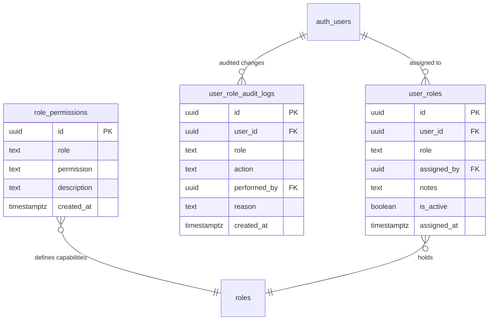

# KhelGrid — Phase 3: Role-Based Access Control (RBAC) Architecture
## Architectural Specification & Security Enforcement Model

**Document:** Phase 3 RBAC Architecture  
**Programme:** KhelGrid 10-Phase Security and Authorization Programme  
**Module:** Phase 3 — Role-Based Access Control (RBAC)  
**Lead Security Architect:** Antigravity  
**Audit & Design Date:** November 8, 2026  
**Target Environment:** Development Database `hznsbxvovjxvmnchzzqt` (PREPARED ONLY — NOT YET APPLIED)  
**Production Site:** `https://khelgrid.com/` (Strictly Out of Scope / Untouched)  

---

## 1. Architectural Philosophy & Guiding Principles

1. **Authentication vs. Role vs. Permission vs. Ownership**:
   - **Authentication (`auth.uid()`):** Verifies *who* the caller is via signed Supabase JWT.
   - **Role (`user_roles`):** Verifies *what trusted role* has been assigned to the user by a verified administrator or platform onboarding.
   - **Permission (`role_permissions`):** Verifies *what abstract capability* the role grants (e.g., `listing:moderate`).
   - **Resource Ownership:** Verifies whether the caller owns the specific row (`user_id = auth.uid()`). A role alone never grants unrestricted access to all records in a category.
   - **Business Authorization:** Verifies stateful eligibility (e.g. valid KYC, NIS credential verification, active subscription).

2. **Decoupled Normalized Storage**:
   - Rather than relying on a mutable column on `public.profiles` or untrusted user metadata in `auth.users`, role assignments are stored in a dedicated, decoupled relation: `public.user_roles`.
   - Direct mutation (`INSERT`, `UPDATE`, `DELETE`) on `public.user_roles` is **strictly revoked** from `PUBLIC`, `anon`, and `authenticated`.
   - Role mutations can only be executed via atomic, auditable `SECURITY DEFINER` administrative procedures: `admin_assign_role` and `admin_revoke_role`.

3. **Multi-Role Support**:
   - A real-world sports community member frequently occupies multiple business functions simultaneously (e.g., a NIS-certified Badminton Coach who is also a Venue Host managing turf courts and a parent of a junior athlete).
   - The normalized `user_roles` model allows multiple active roles per user (`UNIQUE(user_id, role)`) without privilege escalation.

4. **Fail-Closed Default Deny**:
   - Unauthenticated visitors default to role `'visitor'`, possessing read-only public catalogue browsing.
   - Network failure or missing profiles fall back closed. No privileges are ever inferred from failed network calls.

---

## 2. Schema Architecture & Entities



### 2.1 Supported Platform Roles

1. **`visitor`**: Public unauthenticated guest. Read-only access to public directory catalogues (`sports`, `academies`, `venues`, `events`, `cities`).
2. **`athlete`**: Registered sports player. Profile management, Sports CV combine applications, turf booking, review submissions.
3. **`parent`**: Guardian managing junior athletes. Academy inquiries and trial submissions on behalf of wards.
4. **`coach`**: Certified trainer / NIS coach. Training inquiries, prospective candidate combine scouting, official scorekeeping.
5. **`scout`**: Talent scout. Talent scanner access, normative percentiles evaluation, candidate dossier export.
6. **`academy`**: Academy director. Admission inquiries management, trial publishing, verified CV candidate review.
7. **`host` / `venue_owner`**: Facility operator. Court slot management, pricing, payout settlement requests, pickup game hosting.
8. **`submitter`**: Directory listing contributor. Submitting listings and tracking review status.
9. **`moderator`**: Content and safety reviewer. Listing approval, review moderation, claim document verification.
10. **`admin`**: System administrator. Role assignment, system configuration, audit inspection.
11. **`service_role`**: Trusted backend system service. Automated ingestion, payment verification webhooks.

---

## 3. Database Enforcement & Privilege Boundaries

### 3.1 Revocation of Client-Side Mutations
```sql
REVOKE INSERT, UPDATE, DELETE ON public.user_roles FROM PUBLIC, anon, authenticated;
REVOKE INSERT, UPDATE, DELETE ON public.role_permissions FROM PUBLIC, anon, authenticated;
REVOKE INSERT, UPDATE, DELETE ON public.user_role_audit_logs FROM PUBLIC, anon, authenticated;
```

### 3.2 Row Level Security Policies
- **`role_permissions`**: Public read-only catalog (`USING (true)`).
- **`user_roles`**: Authenticated users can view only their own assigned roles (`auth.uid() = user_id`). Administrators and service role can view all assignments (`public.is_admin()`).
- **`user_role_audit_logs`**: Strictly accessible to administrators and service role (`public.is_admin()`).
- **FORCE ROW LEVEL SECURITY**: Enforced on `role_permissions`, `user_roles`, and `user_role_audit_logs`.

### 3.3 Atomic Administrative RPCs
- **`public.admin_assign_role(p_target_user_id uuid, p_role text, p_notes text)`**:
  - Verifies caller is admin or service_role.
  - Validates role against strict allowlist.
  - Inserts into `public.user_roles`.
  - Records an immutable entry in `public.user_role_audit_logs`.
  - Synchronizes `public.profiles.role`.
- **`public.admin_revoke_role(p_target_user_id uuid, p_role text, p_reason text)`**:
  - Verifies caller is admin or service_role.
  - **Last-Admin Protection:** Prevents deleting the final remaining platform administrator.
  - Removes role from `public.user_roles`.
  - Records an immutable entry in `public.user_role_audit_logs`.
  - Recalculates highest remaining fallback role for `public.profiles.role`.

---

## 4. Centralized Client-Side Authorization Service (`authorizationService.ts`)

Exported functions:
- `getCurrentUserRoles(userId?: string): Promise<AppRole[]>`
- `hasRole(requiredRole: AppRole, userRoles?: AppRole[]): boolean`
- `hasPermission(permission: AppPermission, userRoles?: AppRole[]): boolean`
- `canAccessResource(resource, action, context, ownerId): boolean`
- `canManageListing(listingId, context, submitterId): boolean`
- `canModerateListing(context): boolean`
- `canManageVenue(venueId, context, venueHostId): boolean`
- `canUpdateLiveScore(matchId, context, matchScorerId): boolean`
- `canManageRoles(context): boolean`

---

## 5. Deployment Safety & Phase 2 Prerequisite

- Phase 3 migrations (`20261108000000`) are held in the repository awaiting Phase 2 database deployment approval.
- **Zero migrations applied to live database.**
- **Production (`https://khelgrid.com/`) completely untouched.**
