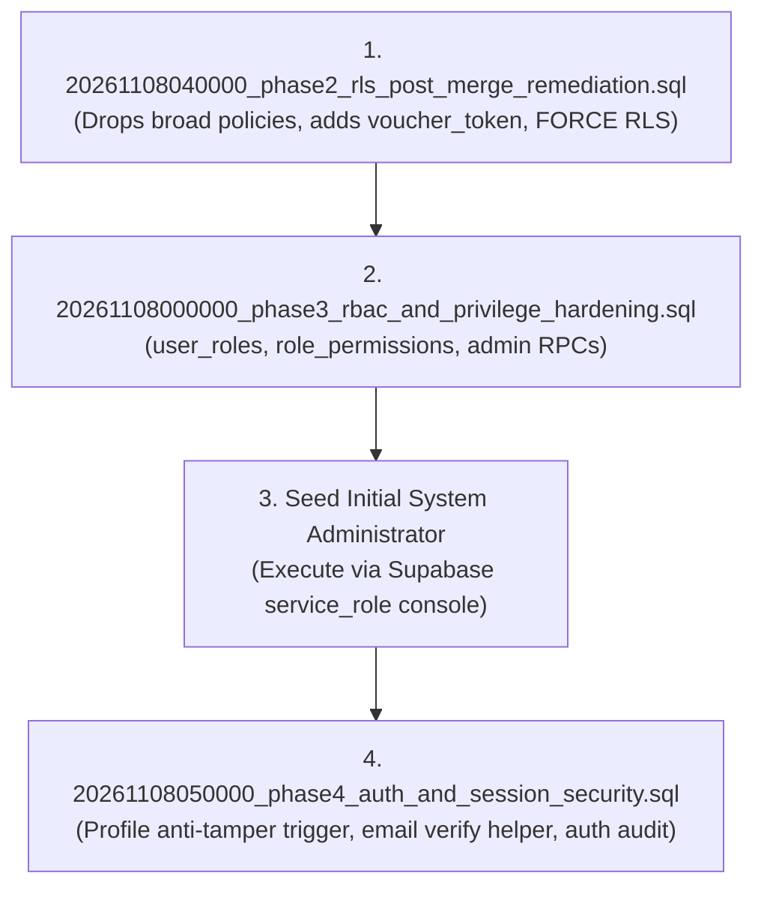

# KhelGrid Security Programme — Phase 4: Deployment Readiness Assessment

**Document ID:** SEC-DOC-P4-07  
**Status:** Ready for Review & Deployment  
**Author:** KhelGrid Application Security & Architecture  
**Date:** November 8, 2026  

---

## 1. Readiness Evaluation

| Evaluation Area | Criteria | Assessment | Evidence |
|---|---|---|---|
| **Code Completeness** | Insecure fallbacks removed; anti-enumeration and open-redirect protections active | **READY** | `auth-client.ts`, `authorizationService.ts` |
| **Stage 0 Closure** | Phase 2 and Phase 3 gaps closed in migration files and tests | **READY** | Hardened `20261108040000`, `20261108000000` |
| **Database Migrations** | Transaction-safe, idempotent, zero destructive operations (no DROP TABLE/TRUNCATE) | **READY** | `20261108040000`, `20261108000000`, `20261108050000` |
| **Automated Testing** | Full test suite passing with dedicated regression suites | **READY** | 82 test files passing (596 tests passed, 0 failures) |
| **Type Integrity** | TypeScript strict build passes without suppressions | **READY** | `tsc -b` reports 0 errors |
| **Database Status** | Migrations NOT yet applied to remote database (pending release approval) | **VERIFIED** | Live database version is `20261106130000` |
| **Production Boundaries** | Production site untouched; no Vercel or DNS changes | **VERIFIED** | Strictly development scope |

---

## 2. Recommended Migration Execution Sequence

When applying migrations to the development database `hznsbxvovjxvmnchzzqt`, execute in the following exact order:



### Rollback Plan
If an anomaly is detected during migration execution:
- Migrations are wrapped in transaction blocks (`BEGIN ... COMMIT`). An unhandled syntax or catalog error rolls back automatically.
- To revert Phase 4 manually:
  ```sql
  DROP TRIGGER IF EXISTS trg_prevent_profile_role_self_escalation ON public.profiles;
  DROP FUNCTION IF EXISTS public.prevent_profile_role_self_escalation();
  DROP FUNCTION IF EXISTS public.is_user_email_verified(uuid);
  DROP FUNCTION IF EXISTS public.get_public_profile(uuid);
  DROP TABLE IF EXISTS public.auth_security_events;
  ```
